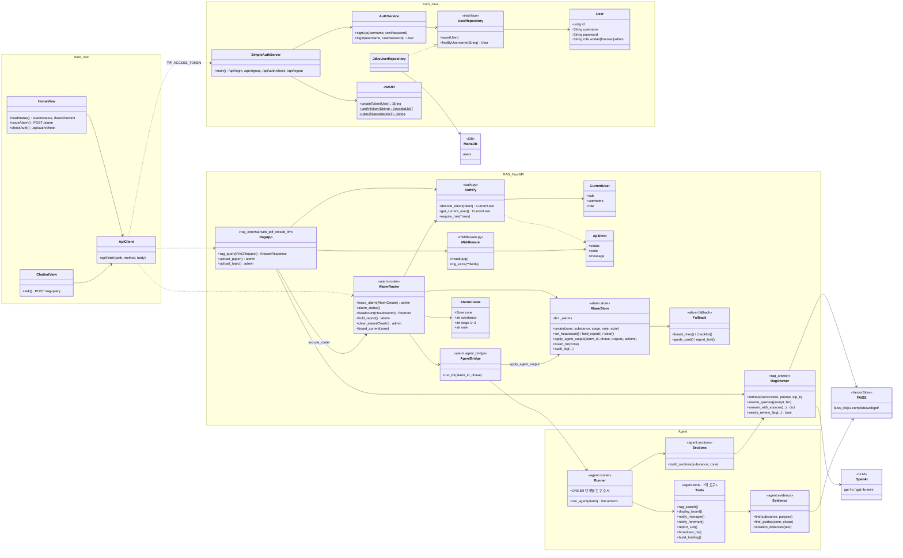
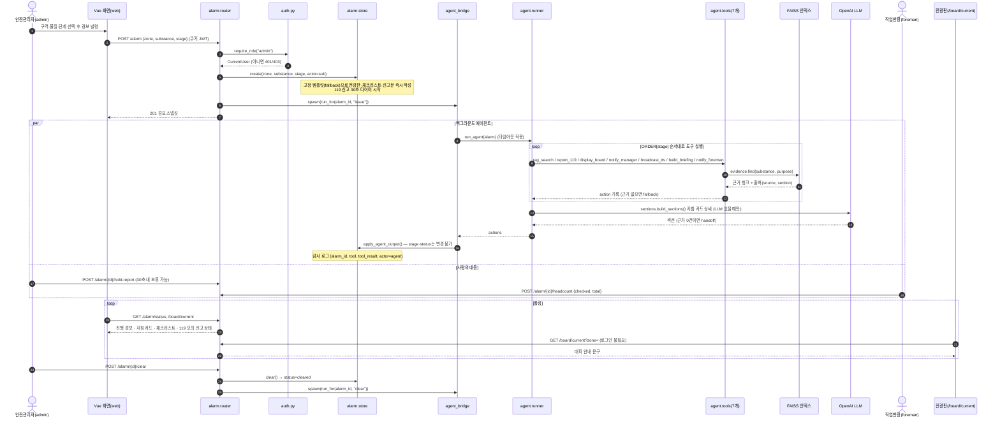
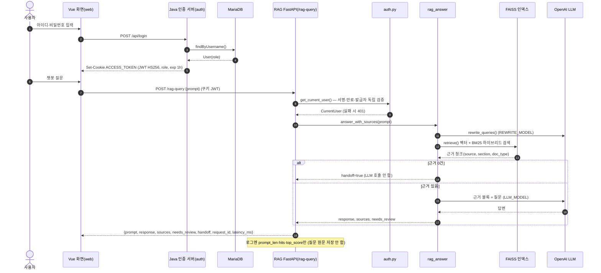

## 🚀 About

정유•화학 유출 비상 대응 AI 에이전트 프로젝트

## 🏗️ Architecture

| 서비스 | 포트 | 역할 |
| --- | --- | --- |
| `web` (Vue 3 + Vite) | 5174 | 홈(경보 발령·현황), 챗봇, 로그인 화면 |
| `auth` (Java HttpServer) | 8080 | 회원가입·로그인, JWT(`ACCESS_TOKEN` 쿠키) 발급 |
| `rag` (FastAPI) | 8001 | `/rag-query` 문서 근거 질의, `/alarm`·`/board/current` 경보 API, 에이전트 |
| `voice` (FastAPI) | 8008 | STT·TTS |
| `db` (MariaDB) | 53301 → 3306 | 회원 정보 |

> 다이어그램 원본(`.mmd`)과 이미지(`.png`)는 [`docs/diagrams/`](docs/diagrams/)에 있습니다.

### 클래스 다이어그램

경보 발령·해제는 사람(`admin`)만 하고, 에이전트는 `agent.tools`의 7개 도구로 문서 근거 기반 안내·연락 업무만 수행합니다. 에이전트 결과는 `alarm.store.apply_agent_output()`을 거쳐 반영되며 단계(stage)·상태(status)는 바꿀 수 없습니다.

🖼️ 이미지: [`docs/diagrams/class-diagram.png`](docs/diagrams/class-diagram.png)

### 시퀀스 다이어그램 — 경보 발령 · 에이전트 대응

🖼️ 이미지: [`docs/diagrams/sequence-alarm.png`](docs/diagrams/sequence-alarm.png)

### 시퀀스 다이어그램 — 로그인 · 챗봇 질의(RAG)

🖼️ 이미지: [`docs/diagrams/sequence-rag.png`](docs/diagrams/sequence-rag.png)

## ⚡Quick Start

## 📦 How to Install
