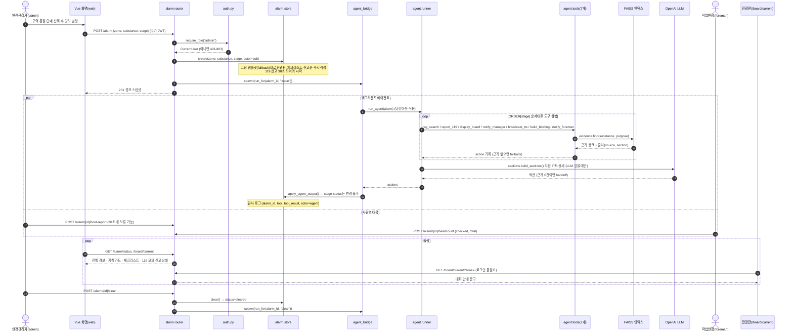
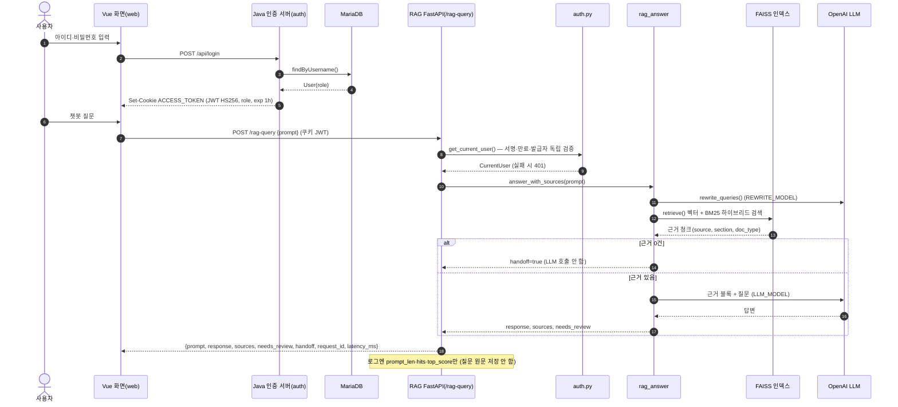

정유·석유화학 현장 비상상황 대응 에이전트

## 🚀 About

### 주제

현장에서 가스 누출·화재·노출 같은 비상상황이 생겨 **안전관리자가 경보(물질·구역·단계)를 발령**하면, 에이전트는 사람이 동시에 하기 어려운 **찾기·정리·안내·연락** 업무를 공개 안전 문서(KOSHA GUIDE, MSDS, 안전보건규칙 등)를 근거로 대신 수행합니다.

- 전광판 대피 안내 문구, 구역 방송 문구
- 안전관리자용 대응 지침 카드, 작업반장용 체크리스트
- 119 신고문 작성과 **모의** 발송 (발령 후 30초 안에 관리자가 보류할 수 있음)
- 작업 전 안전 질문에 답하는 문서 근거 챗봇 (RAG)

사람은 **경보 발령·해제, 대피 지휘, 설비 조작, 현장 판단**처럼 사람만 할 수 있는 일에 집중합니다.

> 경보 상황에서 사람이 막히는 이유는 지식 부족보다 **찾고·정리하고·연락하는 일과 대피 지휘가 같은 시간에 몰리는 것**입니다. HeartSignal은 이 일을 나눕니다.

#### 설계 원칙

- **경보 발령·해제는 사람(`admin`)만** 합니다. 센서·자동 판정은 아직 없고, 에이전트는 경보 단계를 바꿀 수 없습니다.
- 에이전트 도구는 7개(`rag_search`, `display_board`, `notify_manager`, `notify_foreman`, `report_119`, `broadcast_tts`, `build_briefing`)뿐이며, 설비 조작·대피 판단·의료 판단은 하지 않습니다.
- 모든 안내 문장에는 **출처(문서·조항)** 를 붙이고, 근거가 없으면 LLM을 부르지 않고 사람에게 넘깁니다(`handoff`).
- LLM이 장애를 일으켜도 경보·방송·신고는 **고정 템플릿**으로 계속 동작합니다.

### 이해관계자와 가치

| 이해관계자                           | 역할 (`role`)      | 현장에서 막히는 지점                                                                                        | HeartSignal이 주는 가치                                                                                            |
| ------------------------------------ | ------------------ | ----------------------------------------------------------------------------------------------------------- | ------------------------------------------------------------------------------------------------------------------ |
| **안전관리자** (관제실)              | `admin`            | 경보와 동시에 119 신고 정보(물질·UN번호·CAS·이격거리)를 모으고 대피 문구를 만들어야 해서 현장 지휘가 늦어짐 | 경보 발령 한 번으로 **전광판 문구·대응 지침 카드·119 신고문**이 근거와 함께 준비됨. 신고는 보류·해제로 통제권 유지 |
| **현장 작업반장** (정비·출하팀)      | `foreman`          | 문서를 펼 수 없는 상황에서 대피 지시·인원 점검·연락을 동시에 해야 함                                        | 단말에 **근거가 붙은 체크리스트**가 뜨고, 반장은 대피 지휘와 인원 점검 입력에만 집중                               |
| **현장 작업자** (신입 운전원·협력사) | `worker`           | 전광판 안내의 이유를 모르고, 작업 전 기준(산소 농도, 황화수소 ppm 등)이 여러 문서에 흩어져 있음             | 전광판·지침에 **출처가 함께 표시**되고, 챗봇으로 기준과 조문 출처를 쉬운 말로 확인                                 |
| **운전원** (DCS 조작)                | 서비스 사용자 아님 | 차단밸브·비상정지 등 설비 조작                                                                              | 에이전트가 설비를 건드리지 않아 **조작 권한과 책임이 사람에게 그대로** 남음                                        |
| **회사·안전 조직**                   | —                  | 비상 대응 기록이 흩어지고, AI가 판단을 대신한다는 우려                                                      | 도구 실행마다 **감사 로그**(누가·무엇을·결과) 기록, 사람-에이전트 역할 분리로 **책임 소재가 분명**                 |

자세한 기획은 [`docs/HeartSignal-Plan.md`](docs/HeartSignal-Plan.md), 명세는 [`docs/HeartSignal-Spec.md`](docs/HeartSignal-Spec.md)를 참고하세요.

## 🏗️ Architecture

| 서비스                   | 포트         | 역할                                                                      |
| ------------------------ | ------------ | ------------------------------------------------------------------------- |
| `web` (Vue 3 + Vite)     | 5174         | 홈(경보 발령·현황), 챗봇, 로그인 화면                                     |
| `auth` (Java HttpServer) | 8080         | 회원가입·로그인, JWT(`ACCESS_TOKEN` 쿠키) 발급                            |
| `rag` (FastAPI)          | 8001         | `/rag-query` 문서 근거 질의, `/alarm`·`/board/current` 경보 API, 에이전트 |
| `voice` (FastAPI)        | 8008         | STT·TTS                                                                   |
| `db` (MariaDB)           | 53301 → 3306 | 회원 정보                                                                 |

> 다이어그램 원본(`.mmd`)과 이미지(`.png`)는 [`docs/diagrams/`](docs/diagrams/)에 있습니다.

### 클래스 다이어그램

경보 발령·해제는 사람(`admin`)만 하고, 에이전트는 `agent.tools`의 7개 도구로 문서 근거 기반 안내·연락 업무만 수행합니다. 에이전트 결과는 `alarm.store.apply_agent_output()`을 거쳐 반영되며 단계(stage)·상태(status)는 바꿀 수 없습니다.


🖼️ 이미지: [`docs/diagrams/class-diagram.png`](docs/diagrams/class-diagram.png)

### 시퀀스 다이어그램 — 경보 발령 · 에이전트 대응



🖼️ 이미지: [`docs/diagrams/sequence-alarm.png`](docs/diagrams/sequence-alarm.png)

### 시퀀스 다이어그램 — 로그인 · 챗봇 질의(RAG)



🖼️ 이미지: [`docs/diagrams/sequence-rag.png`](docs/diagrams/sequence-rag.png)

## ⚡Quick Start

필요한 도구와 `.env` 준비는 아래 [How to Install](#-how-to-install)을 먼저 마친 뒤 진행하세요. 통합 `docker-compose.yml`은 아직 없으므로 서비스를 각각 실행합니다.

```bash
# 1) DB (MariaDB :53301)
docker compose -f db/docker-compose.yml up -d

# 2) 인증 서버 (:8080)
(set -a && source backend/.env && set +a && cd backend && ./gradlew run)

# 3) 시연 계정 생성: admin1 · foreman1 · worker1 (인증 서버가 떠 있어야 함)
db/seed-demo-users.sh

# 4) RAG + 경보 API (:8001, Swagger http://localhost:8001/docs)
(cd RAG && python -m uvicorn rag_external-web_pdf_closed_llm:app --port 8001 --reload)

# 5) 화면 (:5174)
(cd web && npm run dev)

# 6) (선택) 음성 STT·TTS (:8008)
(cd Voice-AI && python -m uvicorn app.main:app --port 8008 --reload)
```

각 서버는 터미널을 따로 열어 실행합니다. 그다음 http://localhost:5174 에 접속해 데모 시나리오 **S1(출하장 프로판 누출, 3단계)** 을 확인합니다.

1. `admin1`로 로그인 → 홈에서 **출하장 · 프로판 · 3단계** 경보 발령
2. 전광판 대피 문구, 관리자 대응 지침 카드, 119 모의 신고(30초 안에 보류 가능)가 출처와 함께 표시되는지 확인
3. `foreman1`로 로그인 → 체크리스트 확인, 인원 점검 결과 입력
4. 챗봇 화면에서 질문 (예: "밀폐공간 진입 전 산소 농도 기준은?") → 답변과 출처 확인
5. `admin1`로 경보 해제

> `OPENAI_API_KEY`가 없어도 RAG 서버는 기동합니다. 이때 챗봇(`/rag-query`)은 503 `NOT_READY`를 돌려주고, 경보 에이전트는 문서 근거와 고정 템플릿으로 동작합니다.

## 📦 How to Install

### 1. 사전 준비

| 도구                  | 버전    | 용도                                   |
| --------------------- | ------- | -------------------------------------- |
| Docker (Compose 포함) | 최신    | MariaDB                                |
| JDK                   | 17 이상 | 인증 서버 (`backend/`)                 |
| Python                | 3.11    | RAG (`RAG/`), 음성 (`Voice-AI/`)       |
| Node.js · npm         | LTS     | 화면 (`web/`)                          |
| ffmpeg                | —       | 음성 STT (선택, `brew install ffmpeg`) |

### 2. 저장소 받기

```bash
git clone https://github.com/ForSKALA/HeartSignal.git
cd HeartSignal
```

### 3. 환경변수 파일 만들기

각 `.env-example`을 복사해 값을 채웁니다. **`.env`는 커밋하지 않습니다.** `JWT_SECRET`은 인증 서버와 Python 서비스가 **같은 값**이어야 합니다.

```bash
cp db/.env-example db/.env                    # DB_PASSWORD, SEED_*_PASSWORD
cp backend/.env-example backend/.env          # DB_PASSWORD, JWT_SECRET
cp RAG/.env-example RAG/.env                  # OPENAI_API_KEY, JWT_SECRET
cp Voice-AI/app/.env-example Voice-AI/app/.env  # (선택) OPENAI_API_KEY, JWT_SECRET
```

변수 전체 목록과 의미는 [`AGENTS.md` 6장](AGENTS.md#6-환경변수-env)을 참고하세요.

### 4. 의존성 설치

```bash
# RAG
cd RAG && python -m venv .venv && source .venv/bin/activate && pip install -r requirements-e.txt && cd ..

# 화면
cd web && npm ci && cd ..

# (선택) 음성
cd Voice-AI && pip install -r requirements.txt && cd ..
```

인증 서버는 `./gradlew run` 실행 시 Gradle이 의존성을 받습니다.

### 5. 검색 인덱스

FAISS 인덱스(`RAG/faiss_db/p1-complete/`)는 저장소에 포함되어 있어 바로 사용할 수 있습니다. 원본 문서(`안전지침/`)로 다시 만들 때만 `RAG/scripts/ingest.py`를 실행합니다. 자료 출처는 [`docs/data_sources.md`](docs/data_sources.md)에 있습니다.

### 6. 테스트

```bash
cd RAG && pip install -r requirements-test.txt && python -m pytest
```

### 7. 배포 (Kubernetes)

컨테이너 이미지 빌드·푸시는 각 서비스의 `docker-build.sh`·`docker-push.sh`를, 클러스터 배포는 [`docs/k8s-deploy-guide.md`](docs/k8s-deploy-guide.md)를 참고하세요.
