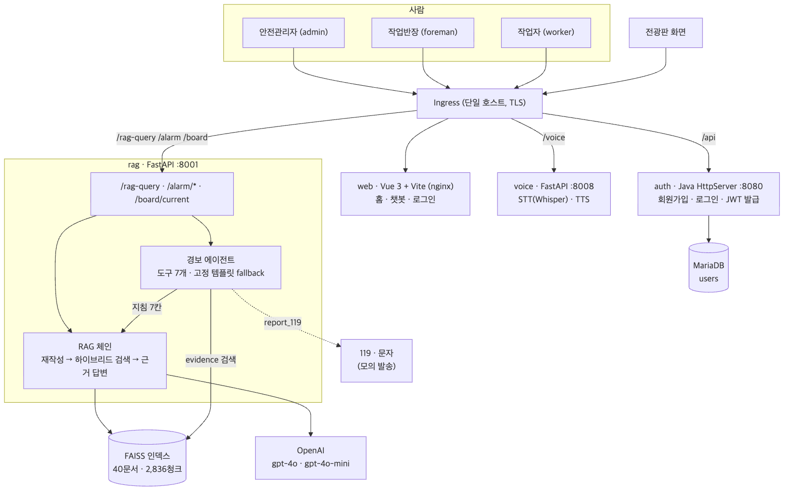
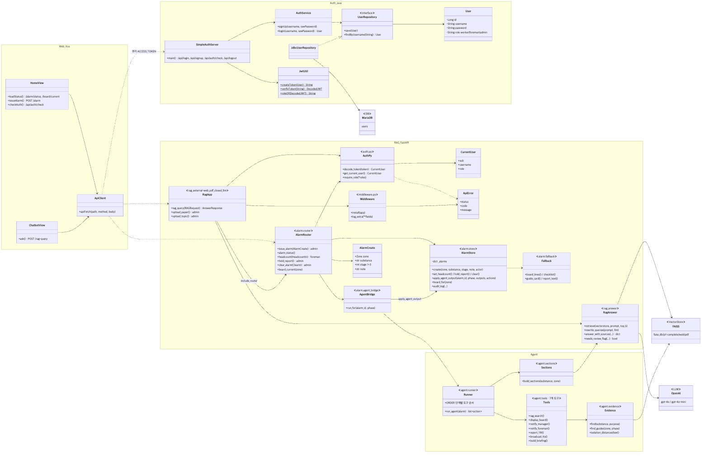
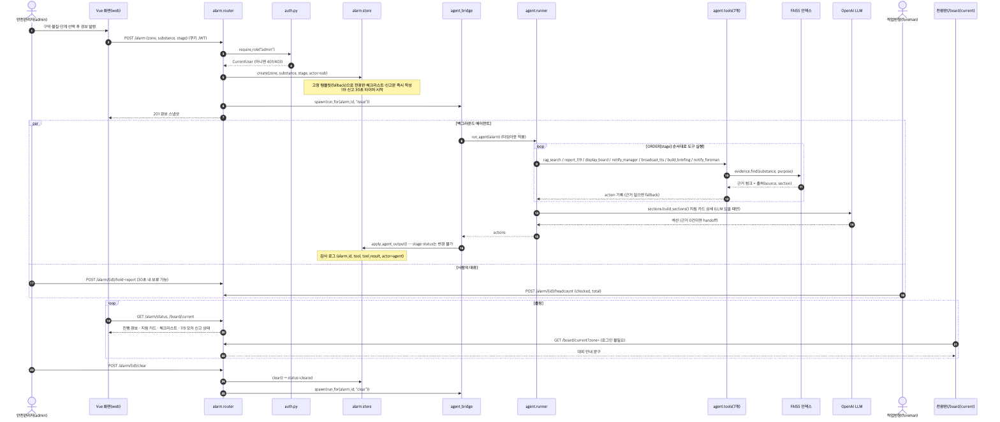
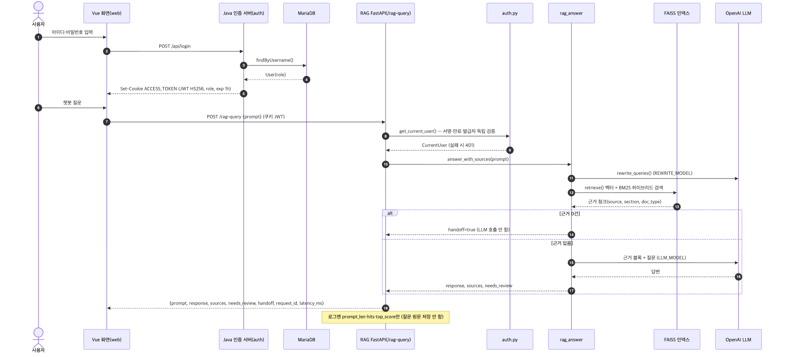

# HeartSignal 기획서

### 정유·석유화학 현장 비상상황 대응 에이전트

---

## 목차

1. 개요
2. 이해관계자와 가치
3. 핵심 설계 원칙
4. 아키텍처
5. 데이터와 RAG
6. 경보 에이전트
7. 평가와 개선
8. 서비스화와 배포
9. 비즈니스 모델
10. 팀 역할
11. 동작 화면

---

## 1. 개요

### 1.1 한 줄 소개

현장에 가스 누출·화재·노출 같은 비상상황이 생겨 **안전관리자가 경보(물질·구역·단계)를 발령**하면, 에이전트가 **공개 안전 문서를 근거로** 전광판 대피 안내, 관리자 대응 지침, 구역 방송, 작업반장 체크리스트, 119 신고문을 만들고 전달합니다. 사람은 **대피, 지휘, 설비 조작, 현장 판단**에 집중합니다.

### 1.2 문제 정의

| #   | 누가                 | 업무 상황                            | 무엇을 찾다가                                      | 어디서 막히나                                                                                                               | HeartSignal 연결                                                                              |
| --- | -------------------- | ------------------------------------ | -------------------------------------------------- | --------------------------------------------------------------------------------------------------------------------------- | --------------------------------------------------------------------------------------------- |
| W1  | 출하팀 작업반장      | 탱크로리 프로판 출하 중 가스 경보    | 출하를 멈춰야 하나? 차량 시동은? 재개 조건은?      | 절차가 KOSHA G-78 10.2에 있지만 현장에서 문서를 펼 수 없음. 동시에 대피 지시와 119·인근 공장 연락까지 해야 해서 손이 모자람 | 에이전트가 전광판 대피 문구·119 신고 정보를 정리하고, 반장 단말에 G-78 근거 체크리스트를 띄움 |
| W2  | 정비팀 작업반장      | 정기보수 중 증류탑 맨홀 개방 작업 전 | 황화철 자연발화 징후인가? 물을 얼마나 뿌려?        | P-64(황화철) 지침을 아는 사람이 드묾                                                                                        | 작업 전 RAG 질의로 P-64 근거 제공                                                             |
| W3  | 밀폐공간 진입 작업자 | 탱크 내부 진입 전 공기 측정          | 산소 몇 %부터 위험? 황화수소 몇 ppm까지?           | 기준이 안전보건규칙 제618조·노출기준 고시에 흩어져 있음. 용어(H2S·황화수소) 혼용                                            | RAG 질의로 기준과 조문 출처 답변                                                              |
| W4  | 안전관리자           | 3단계 경보, 119 신고                 | 물질명·UN번호·CAS·위치·이격거리를 정리해 말해야 함 | 정보가 MSDS·안전지침·관제 화면에 흩어짐. 신고 중에는 현장 지휘 불가                                                         | 에이전트가 문서 근거로 신고문 작성·모의 발송 (관리자 보류 가능)                               |
| W5  | 안전관리자           | 독성가스 누출, 대피 안내             | 몇 m까지 위험? 작업자에게 어떻게 알려?             | 초기이격거리가 물질마다 다르고 안내 문구를 즉석에서 만들어야 함                                                             | 초기이격거리 근거로 전광판 접근금지 문구와 대응 지침 카드 작성                                |
| W6  | 현장 작업자          | 전광판에 "반경 30m 접근 금지" 표시   | 왜 30m야?                                          | 안내의 근거를 모름                                                                                                          | 전광판·지침에 출처를 함께 표시, 챗봇으로 쉬운 설명                                            |

> 경보 상황에서 사람이 막히는 이유는 지식 부족보다 **찾고·정리하고·연락하는 일과 대피 지휘가 같은 시간에 몰리는 것**입니다. 그래서 에이전트는 찾기·정리·연락을 맡고, 사람은 사람만 할 수 있는 일을 맡습니다.

### 1.3 사용자

| 사용자                                    | 하는 일                                       | 서비스 역할(`role`) |
| ----------------------------------------- | --------------------------------------------- | ------------------- |
| 현장 작업반장 (협력사 정비팀·출하팀 반장) | 작업 지휘, 경보 시 대피 지시·인원 점검        | `foreman`           |
| 현장 작업자 (신입 운전원·협력사 작업자)   | 작업 수행, 작업 전 안전 질문                  | `worker`            |
| 안전관리자 (관제실)                       | 경보 발령·해제, 비상조치 가동, 대외 연락 책임 | `admin`             |

---

## 2. 이해관계자와 가치

### 2.1 구매자와 사용자

| 구분            | 누구                          | 관심사                                                           |
| --------------- | ----------------------------- | ---------------------------------------------------------------- |
| **사용자**      | 작업반장, 작업자, 안전관리자  | 비상시 손이 덜 가는가, 안내가 정확한가                           |
| **구매 결정자** | 안전환경팀장, CSO, 경영책임자 | 법적 의무를 이행했다는 **증거가 남는가**, 대응 시간이 줄어드는가 |

> "비상 대응 시간을 줄이고, 그 대응을 했다는 증거를 자동으로 남긴다."

### 2.2 이해관계자별 가치

| 이해관계자         | 현장에서 막히는 지점                                                              | HeartSignal이 주는 가치                                                                                           |
| ------------------ | --------------------------------------------------------------------------------- | ----------------------------------------------------------------------------------------------------------------- |
| **안전관리자**     | 경보와 동시에 119 신고 정보를 모으고 대피 문구를 만들어야 해서 현장 지휘가 늦어짐 | 경보 발령 한 번으로 전광판 문구·대응 지침 카드·119 신고문이 근거와 함께 준비됨. 신고 보류·경보 해제로 통제권 유지 |
| **작업반장**       | 문서를 펼 수 없는 상황에서 대피 지시·인원 점검·연락을 동시에 해야 함              | 단말에 근거가 붙은 체크리스트, 반장은 대피 지휘와 인원 점검 입력에만 집중                                         |
| **작업자**         | 전광판 안내의 이유를 모르고, 작업 전 기준이 여러 문서에 흩어져 있음               | 전광판·지침에 출처 표시, 챗봇으로 기준과 조문 출처 확인                                                           |
| **운전원**         | 설비 조작                                                                         | 에이전트가 설비를 건드리지 않아 조작 권한과 책임이 사람에게 그대로 남음                                           |
| **회사·안전 조직** | 대응 기록이 흩어지고, AI가 판단을 대신한다는 우려                                 | 도구 실행마다 감사 로그, 사람-에이전트 역할 분리로 책임 소재가 분명                                               |

---

## 3. 핵심 설계 원칙

### 3.1 원칙

1. **경보 발령·해제는 사람(`admin`)만 합니다.** 센서·자동 판정은 아직 없습니다. 에이전트 코드에는 경보 단계를 정하거나 바꾸는 함수가 없고, 에이전트 결과는 `apply_agent_output()`을 거쳐 허용된 필드(전광판 문구, 지침 카드, 체크리스트, 브리핑, 신고문 내용)만 반영됩니다.
2. **대응 문장은 검색된 문서에서만** 가져오고 출처를 붙입니다. 근거가 0건이면 LLM을 호출하지 않고 `handoff: true`로 사람에게 넘깁니다.
3. **LLM 장애 시에도** 경보·방송·신고는 고정 템플릿으로 동작합니다.
4. 비밀값은 `.env`·k8s Secret으로만 관리하고, 로그에는 질문 원문·음성 원본을 남기지 않습니다.

| 누가           | 하는 일                                                    | 하지 않는 일                                         |
| -------------- | ---------------------------------------------------------- | ---------------------------------------------------- |
| **안전관리자** | 경보 발령, 119 신고 보류(30초 내), 경보 해제, 재개 승인    | —                                                    |
| **에이전트**   | 문서 검색 → 전광판·지침·방송·체크리스트·신고문 작성 → 전달 | 경보 단계 판정·해제, 대피 판단, 설비 조작, 의료 판단 |
| **작업반장**   | 작업 중지, 대피 지시, 인원 점검                            | 신고·대외 연락 (에이전트가 대신)                     |
| **운전원**     | 차단밸브·ESD 등 설비 조작                                  | —                                                    |

### 3.2 단계별 역할표

| 단계          | 단계 의미 (참고)                        | 🤖 에이전트 (도구 실행 순서)                                                                                                                                                                     | 👷 작업반장                                 | 🧑‍💼 안전관리자                              | 🔧 운전원         |
| ------------- | --------------------------------------- | ------------------------------------------------------------------------------------------------------------------------------------------------------------------------------------------------ | ------------------------------------------- | ------------------------------------------ | ----------------- |
| 🟡 **1 주의** | TWA 초과 또는 상승 추세                 | `rag_search` → `broadcast_tts`(주의 방송) → `notify_foreman`(점검 체크리스트) → `notify_manager`(대응 지침 카드)                                                                                 | 재측정, 작업 계속/일시중지 판단             | 관제 화면 확인                             | 공정 이상 확인    |
| 🟠 **2 경고** | LEL 25%, 산소 18% 미만 등 공식 1차 경보 | `rag_search` → `broadcast_tts`(작업 중지·대피 준비) → `notify_foreman`(대피 경로·집결지) → `notify_manager` → `display_board`                                                                    | 작업 중지, 보호구 착용, 대피 지시·인원 점검 | 비상조치계획 가동 판단                     | 차단밸브 준비     |
| 🔴 **3 위험** | IDLH 또는 LEL 50%                       | `rag_search` → `report_119`(30초 보류창 → 모의 발송) → `display_board`(대피·접근금지 반경) → `notify_manager` → `broadcast_tts`(전 구역 대피) → `build_briefing`(소방 브리핑) → `notify_foreman` | 대피 유도, 인원 점검 결과 입력              | 신고 보류(오경보 시), 현장 지휘, 소방 인계 | ESD·차단밸브 조작 |
| ⬜ **해제**   | 자동 해제 없음                          | `rag_search` → `broadcast_tts`·`display_board`(해제·재개 안내) → `notify_foreman`                                                                                                                | 재측정 결과 보고                            | 경보 해제, 작업 재개 승인                  | 설비 정상화       |

> "단계 의미" 열은 각 단계를 설명하는 참고 근거(KOSHA P-135·P-136, 안전보건규칙 제618조)이며, 서비스는 센서 값으로 단계를 판정하지 않습니다.

---

## 4. 아키텍처

### 4.1 서비스 구성



| 서비스  | 기술                               | 포트             | 역할                                                                 |
| ------- | ---------------------------------- | ---------------- | -------------------------------------------------------------------- |
| `web`   | Vue 3 + Vite, nginx                | 5174 (개발) / 80 | 홈(평상시·경보·해제), 챗봇, 로그인·회원가입                          |
| `auth`  | Java `HttpServer`, JDBC, auth0 JWT | 8080             | 회원가입·로그인, JWT 발급 (`ACCESS_TOKEN` 쿠키)                      |
| `rag`   | FastAPI, LangChain, FAISS          | 8001             | `/rag-query` 근거 질의, `/alarm`·`/board/current` 경보 API, 에이전트 |
| `voice` | FastAPI, Whisper, OpenAI TTS       | 8008             | 음성 질문 인식(STT), 음성 안내(TTS)                                  |
| `db`    | MariaDB 11.4                       | 53301 → 3306     | 회원 정보 (`users`, `role` 포함)                                     |

### 4.2 인증 흐름

- **발급**: Java `JwtUtil`이 HS256으로 서명한 JWT를 발급합니다. 클레임은 `iss=simple-auth-server`, `sub`(사용자 id), `username`, `role`(`worker`·`foreman`·`admin`), `exp`(1시간)입니다.
- **전달**: 브라우저는 `ACCESS_TOKEN` 쿠키로 보냅니다. Ingress 호스트를 하나로 묶어 모든 서비스가 같은 쿠키를 받습니다.
- **검증**: 각 Python 서비스가 회원 DB에 접근하지 않고 **독립적으로** 서명·만료·발급자·role을 검증합니다. `role` 클레임이 없으면 `worker`로 간주하고, 화면이 보낸 role 값은 믿지 않습니다.
- **권한**: 경보 발령·해제·신고 보류·문서 업로드는 `admin`, 인원 점검 입력은 `foreman`만 허용합니다. 전광판 조회(`/board/current`)는 로그인 없이 볼 수 있습니다.

### 4.3 오류 응답 규약

```json
{
    "error": {
        "code": "UNAUTHORIZED",
        "message": "토큰이 만료되었습니다.",
        "request_id": "a1b2c3"
    }
}
```

| HTTP | code                        | 상황                                  |
| ---- | --------------------------- | ------------------------------------- |
| 401  | `UNAUTHORIZED`              | 토큰 없음·만료·서명 오류              |
| 403  | `FORBIDDEN`                 | role 불일치                           |
| 422  | `VALIDATION_ERROR`          | 입력 스키마 오류                      |
| 503  | `NOT_READY` / `LLM_TIMEOUT` | 인덱스·API 키 미준비, LLM 타임아웃    |
| 500  | `INTERNAL`                  | 그 외 (스택트레이스·비밀값 노출 금지) |

### 4.4 클래스 다이어그램



- **web**: `HomeView`·`ChatbotView`가 공통 `apiFetch()`로 서버를 호출하고, 표준 오류 형식을 화면 오류로 바꿉니다.
- **auth**: `SimpleAuthServer` → `AuthService` → `UserRepository`(인터페이스) ← `JdbcUserRepository` → MariaDB. 토큰은 `JwtUtil`이 만듭니다.
- **rag**: `auth.py`(JWT 검증·`require_role`), `middleware.py`(request_id·표준 오류·JSON 로그), `rag_answer.py`(검색·답변), `alarm/`(경보 API·상태 저장·에이전트 연결·고정 템플릿).
- **agent**: `runner`가 단계별 순서(`ORDER`)로 `tools`의 7개 도구를 실행하고, 도구는 `evidence`로 문서 근거를 찾습니다. 지침 카드 상세 7칸은 `sections`가 RAG 체인으로 만듭니다.

### 4.5 시퀀스 다이어그램 — 경보 발령 · 에이전트 대응



1. 안전관리자가 `POST /alarm`으로 구역·물질·단계를 보냅니다. 서버는 `admin`이 아니면 403으로 막습니다.
2. 서버는 **고정 템플릿으로 전광판·체크리스트·신고문을 즉시** 만들고 응답합니다. 3단계면 119 신고 30초 타이머를 시작합니다.
3. 에이전트는 백그라운드에서 단계별 순서대로 도구를 실행하고, 문서 근거를 찾으면 템플릿 문구를 근거 문구로 바꿉니다. 에이전트가 실패하거나 시간을 넘겨도 경보는 템플릿으로 계속 동작합니다.
4. 안전관리자는 30초 안에 신고를 보류할 수 있고, 작업반장은 인원 점검 결과를 입력합니다.
5. 화면은 2.5초마다 상태를 조회합니다. 해제도 사람(`admin`)만 하며, 해제 후 에이전트가 해제·재개 안내를 만듭니다.

### 4.6 시퀀스 다이어그램 — 로그인 · 챗봇 질의



1. 로그인하면 Java 서버가 JWT 쿠키를 발급합니다.
2. 챗봇 질문은 `POST /rag-query`로 가고, RAG 서버가 토큰을 독립 검증합니다.
3. 가벼운 모델(`gpt-4o-mini`)이 질문을 문서 문체 검색어로 바꾸고, 벡터 + BM25 하이브리드 검색을 합니다.
4. 근거가 0건이면 LLM을 호출하지 않고 `handoff: true`를 돌려줍니다. 근거가 있으면 `gpt-4o`가 근거 블록만으로 답하고 출처를 붙입니다.
5. 응답은 기존 필드 `prompt`·`response`를 유지하고 `sources`·`needs_review`·`handoff`·`request_id`·`latency_ms`를 추가했습니다.

---

## 5. 데이터와 RAG

### 5.1 적재 자료

공개 문서만 수동으로 내려받아 사용했습니다 (사이트 자동 크롤링 없음). 총 **40문서, 2,836청크**입니다.

| 구분              | 자료                                                                                                                            | 용도                                |
| ----------------- | ------------------------------------------------------------------------------------------------------------------------------- | ----------------------------------- |
| KOSHA GUIDE       | G-78-2021(출하·저장), P-64-2012(황화철), E-G-18-2026(밀폐공간), A-G-14-2026, C-C-87-2026, H-117-2019(황화수소 중독), P-139-2013 | 절차·체크리스트 근거                |
| 안전보건공단 MSDS | 프로판, 황화수소, 이산화황, 수소, 메테인, 에틸렌, 아세틸렌, 부타디엔                                                            | 기존 안전지침 PDF의 "자료없음" 보완 |
| 법령·고시         | 산업안전보건기준에 관한 규칙(제618조 등), 노출기준 고시(고용노동부고시 제2020-48호)                                             | 적정공기·노출기준                   |
| 화학물질안전원    | 사고대비물질 키인포가이드 (2024)                                                                                                | 물질 기본 정보                      |
| 안전지침 PDF      | 22종 (암모니아, 염소, 벤젠, 톨루엔, 황산 등)                                                                                    | 초기이격거리, 응급조치, CAS·UN·GHS  |

### 5.2 청킹과 메타데이터

- **항목 단위 청킹**: 문서의 절·항목(예: `10.2(13)`, `응급조치>흡입`) 하나를 한 청크로 만들었습니다. 1,000자 고정 청킹에서는 한 청크에 "사방 50m 격리"와 "초기이격거리 30m"가 섞여 오답이 났는데, 항목 단위로 바꾸면서 해결됐습니다.
- **"자료없음" 항목 제외**: 원본 안전지침의 "자료없음" 항목은 청크로 만들지 않습니다. 에이전트가 문장을 지어내지 않도록 하기 위함입니다.
- **재현 가능한 적재**: `RAG/scripts/ingest.py`를 다시 실행하면 같은 청크 수가 나오고, 원본 SHA-256과 출처표(`docs/data_sources.md`)를 함께 생성합니다.

| 메타데이터  | 필수        | 예시                                         |
| ----------- | ----------- | -------------------------------------------- |
| `source`    | ✅          | `KOSHA GUIDE G-78-2021`, `안전지침/염소.pdf` |
| `section`   | ✅          | `10.2(13)`, `응급조치>흡입`, `제618조`       |
| `doc_type`  | ✅          | `emergency` / `guide` / `law`                |
| `substance` | 물질 문서만 | `chlorine`                                   |
| `cas`       | 물질 문서만 | `7782-50-5`                                  |
| `published` | 가능하면    | `2021-12`                                    |

### 5.3 검색과 답변

| 단계            | 방식                                                                                                                         | 이유                                                                             |
| --------------- | ---------------------------------------------------------------------------------------------------------------------------- | -------------------------------------------------------------------------------- |
| 물질 인식       | 질문의 물질명·화학식·약어(22종 사전, 예: H2S·NH3·LPG)를 인식해 해당 물질 청크와 일반 문서만 검색, 다른 물질 청크 제외        | 다른 물질의 비슷한 "응급조치" 항목이 먼저 잡히는 문제 해결                       |
| 저장소 병합     | PDF 인덱스와 법령(web) 인덱스를 함께 검색해 거리순 병합                                                                      | 제618조 등 법령이 web 인덱스에 있음                                              |
| 검색어 재작성   | `gpt-4o-mini`가 질문을 지침·MSDS 문체 검색어 2개로 바꿈. 현장 말 → 문서 표현 어휘표 사용 (새다 → 누출, 프로판 → 인화성 물질) | "프로판이 새면 뭐부터 해?"가 G-78 10.2(13)과 표현이 달라 60위 밖 → 재작성 후 1위 |
| 하이브리드 검색 | 벡터 검색 + BM25(글자 2-gram)를 가중 0.5로 융합(RRF)                                                                         | 조항 번호·물질명처럼 정확히 일치해야 하는 단어 보강                              |
| 답변 게이트     | 의료 판단·실시간 측정값·범위 밖 질문은 `N/A`. 수치는 원문 그대로, 문장마다 `[문서 n]` 인용, temperature 0                    | 근거 밖 지식·의료 판단 차단, 결과 재현성                                         |
| 출처            | 실제로 인용한 청크만 `sources`로 반환                                                                                        | 검색된 10~20청크가 모두 출처로 나가던 문제 해결                                  |
| `needs_review`  | 답변 숫자가 근거·질문에 없거나 인용 표기가 없으면 `true`                                                                     | 파생 수치 경고                                                                   |
| `handoff`       | 근거 0건이면 LLM 미호출, 고정 문구                                                                                           | 지어낸 답변 방지                                                                 |

---

## 6. 경보 에이전트

### 6.1 도구 7개

| 도구             | 출력                                                                          | 근거 자료                                          |   LLM    |
| ---------------- | ----------------------------------------------------------------------------- | -------------------------------------------------- | :------: |
| `rag_search`     | 물질·구역에 맞는 근거 묶음 (청크 + 출처)                                      | 전체 인덱스                                        |    ❌    |
| `display_board`  | 전광판 문구 3~4줄 + 출처, 초기이격거리가 있으면 "접근 금지 반경 ○○m"          | 고정 템플릿 + 안전지침 초기이격거리                |    ❌    |
| `notify_manager` | 관리자 대응 지침 카드 + 상세 7칸                                              | 안전지침 누출 대처·응급조치·기본 물질 정보         | 7칸만 ✅ |
| `notify_foreman` | 작업반장 체크리스트 (항목별 출처)                                             | 구역별 KOSHA 조항 + 보호구 문서 + 단계별 고정 항목 |    ❌    |
| `report_119`     | 119 신고문 (물질·CAS·UN·GHS·이격거리·인원 점검), 상태 `pending`→`held`/`sent` | 안전지침 기본 물질 정보                            |    ❌    |
| `broadcast_tts`  | 구역 방송 문구 (전광판과 같은 근거)                                           | `display_board` 결과                               |    ✅    |
| `build_briefing` | 소방 도착 시 브리핑 카드 (MSDS 요약)                                          | 안전지침 응급조치·누출 대처                        |    ❌    |

### 6.2 장애에 강한 구조

- 경보 발령 즉시 **고정 템플릿**(`RAG/alarm/fallback.py`, `RAG/prompts/board_templates.json`)으로 전광판·체크리스트·신고문을 만들고, 에이전트 결과는 나중에 덮어씁니다.
- 도구 하나가 실패해도 그 도구만 `ok: false, fallback: true`로 기록하고 나머지는 계속 실행합니다. 에이전트 전체가 타임아웃되어도 경보는 멈추지 않습니다.
- `OPENAI_API_KEY`가 없어도 RAG 서버는 기동합니다. 이때 챗봇은 503 `NOT_READY`, 지침 7칸은 빈 상태이고 전광판·방송·체크리스트·119 신고는 그대로 동작합니다.
- 해제된 뒤 늦게 도착한 발령 대응 결과는 버립니다.

### 6.3 감사 로그

도구 실행과 사람의 조작마다 JSON 한 줄을 남깁니다: `alarm_id`, `zone`, `substance`, `stage`, `tool`, `tool_result`(`ok`/`fail`/`fallback`), `actor`(`agent` 또는 사람의 `sub`).

---

## 7. 평가와 개선

### 7.1 평가 방법

- **평가셋** (`RAG/eval/questions.jsonl`): 현장 업무 장면에서 뽑은 핵심 질문 10개, handoff 질문 3개("3번 탱크 지금 압력 몇이야?", "두통이 있는데 중독인가요?", "회사 휴가 규정 알려줘"), 현장 말투·약어 변형 질문 10개
- **규칙**: 한 번에 하나만 바꾸고 다시 측정합니다. 9행부터는 질문당 3회 반복 평균입니다.

| 지표           | 정의                                                       |
| -------------- | ---------------------------------------------------------- |
| 정확성         | 핵심 질문의 키워드가 답변에 모두 들어 있는 비율            |
| 근거성         | 기대 출처 문서 중 하나가 응답 `sources`에 있는 비율        |
| 절 일치        | 기대 출처의 절(section)까지 일치하는 비율                  |
| 무근거 답변률  | 거절하지 않고 답했는데 기대 출처가 없는 비율 (환각률 대용) |
| handoff 적중률 | handoff 질문에서 `handoff=true`이거나 거절한 비율          |

### 7.2 개선 과정 비교표

| #   | 변경 (하나만)                                        | 정확성   | 근거성   | 절 일치  | 무근거 답변률 | handoff    | 평균 지연    |
| --- | ---------------------------------------------------- | -------- | -------- | -------- | ------------- | ---------- | ------------ |
| 0   | **기준선** (베이스 코드 그대로, 1,000자 청킹 99청크) | 20%      | 0%       | —        | 50%           | 100%       | 2.2초        |
| 1   | 응답 계약 (`sources`·`handoff`·503)                  | 20%      | 10%      | —        | 40%           | 100%       | 2.6초        |
| 2   | P1 정식 인덱스 (항목 단위 2,836청크)                 | 40%      | 50%      | —        | 10%           | 100%       | 1.8초        |
| 3   | 물질 인식 검색 제한                                  | 50%      | 60%      | —        | 20%           | 100%       | 1.9초        |
| 4   | 법령 web 인덱스 함께 검색                            | 60%      | 70%      | —        | 20%           | 100%       | 2.6초        |
| 5   | LLM 검색어 재작성                                    | 60%      | 90%      | —        | 10%           | **67% ⚠️** | **5.8초 ⚠️** |
| 6   | 프롬프트 게이트 + 인용                               | 40%      | 60%      | —        | 10%           | 100% ✅    | 6.3초        |
| 7   | temperature 0                                        | 50%      | 70%      | —        | 10%           | 100%       | 6.6초        |
| 8   | 지연 최적화 (재작성 모델 경량화, 임베딩 재사용)      | 50%      | 70%      | —        | 10%           | 100%       | **3.8초**    |
| 9   | 지표 보강 (3회 반복, 절 일치 추가)                   | 40%      | 53%      | 40%      | 10%           | 100%       | 3.6초        |
| 10  | 게이트 완화 (일부만 답할 수 있으면 근거 범위만 답함) | 60%      | 83%      | 60%      | 0%            | 100%       | 3.7초        |
| 11  | BM25 보조 검색 + RRF                                 | 50% ⚠️   | 50%      | 50%      | 13%           | 100%       | 3.4초        |
| 12  | 융합 가중 수정 (BM25 0.5)                            | 70%      | 70%      | 70%      | 10%           | 100%       | 3.6초        |
| 13  | 재작성 어휘표                                        | 80%      | 80%      | 80%      | 0%            | 100%       | 3.3초        |
| 14  | `needs_review` 구현                                  | 80%      | 90%      | 80%      | 0%            | 100%       | 3.4초        |
| 17  | 최종 확인 (코드 변경 없음)                           | 77%      | 87%      | 77%      | 0%            | 100%       | 3.5초        |
| 18  | Q8·Q10 정답 기준 수정 (원문 대조)                    | **100%** | **100%** | **100%** | **0%**        | **100%**   | **3.3초**    |

변형 질문 10개(현장 말투·약어): 정확성 80%, 근거성 90%, 절 일치 90%, 무근거 답변률 0%.

---

## 8. 서비스화와 배포

### 8.1 컨테이너와 Kubernetes

- 서비스마다 `Dockerfile`과 `docker-build.sh`·`docker-push.sh`가 있고, 이미지는 Harbor(`class-4/heartsignal-*`)에 올립니다.
- `class-4` 네임스페이스에 web·auth·rag·voice·db를 배포했습니다. DB는 StatefulSet + PVC입니다.
- **Ingress 호스트 하나**(`heartsignal.class-4.skala-us.com`, 와일드카드 TLS)에서 경로로 나눕니다. 호스트가 하나라서 `ACCESS_TOKEN` 쿠키가 모든 서비스에 전달됩니다.

| Ingress 경로                                           | 서비스 |
| ------------------------------------------------------ | ------ |
| `/`                                                    | web    |
| `/api`, `/login`, `/signup`, `/static`, `/home`        | auth   |
| `/rag-query`, `/alarm`, `/board`, `/upload-*`, `/docs` | rag    |
| `/voice/`                                              | voice  |

### 8.2 설정과 보안

- **비밀값**: `OPENAI_API_KEY`, `JWT_SECRET`, `DB_PASSWORD`는 `.env`(커밋 금지)와 k8s Secret으로만 주입합니다. `.env-example`에는 키 이름만 둡니다.
- **설정값**: `LLM_MODEL`, `REWRITE_MODEL`, `RAG_INDEX_DIR`, `CORS_ORIGINS` 등은 ConfigMap으로 주입합니다.
- **CORS**: `*` 대신 허용 origin을 명시합니다 (쿠키 전송과 함께 쓰기 위해).
- **로그**: JSON 한 줄 로그에 `request_id`, `path`, `status`, `latency_ms`, `user_sub`, `role`, `prompt_len`, `hits`, `top_score`, `needs_review`, `handoff`를 남기고, **질문 원문과 음성 원본은 남기지 않습니다**.
- **서비스 간 호출**: `localhost`를 하드코딩하지 않고 Service 이름과 환경변수를 씁니다.

---

## 9. 비즈니스 모델

### 9.1 이해관계자의 구매 동기

| 구매 결정자 | 구매 동기                                                                                                | HeartSignal의 근거                                      |
| ----------- | -------------------------------------------------------------------------------------------------------- | ------------------------------------------------------- |
| 경영책임자  | 중대재해처벌법상 급박한 위험에 대비한 작업중지·대피 매뉴얼 마련과 반기 1회 이상 점검 의무 (시행령 제4조) | 감사 로그, 사람이 발령·해제하는 구조로 책임 소재가 분명 |
| 안전환경팀  | 화학물질관리법상 화학사고 즉시 신고 의무 (시행규칙상 15분 이내로 파악), PSM 비상조치계획의 실효성        | 119 신고문 자동 정리, 경보 → 신고 소요 시간 측정        |
| 원청·보험사 | 협력사 안전관리 수준 평가                                                                                | 훈련·대응 기록 리포트                                   |

### 9.2 필수 요소

1. **평상시 사용 기능**: 비상 경보는 드물어서, 평소에 쓰이지 않으면 계약 갱신 때 해지됩니다. **훈련(Drill) 모드**로 반기 점검 의무를 채우고, **작업 전 질의 챗봇**을 매일 쓰게 합니다.
2. **규제 대응 증거**: 감사 로그와 대응·훈련 리포트로 법적 의무 이행을 증명하게 합니다.
3. **설치형 배포**: 정유·석유화학 사업장은 망분리가 일반적이라 외부 LLM API를 못 쓸 수 있습니다. 온프레미스 설치와 사내 LLM 교체 옵션이 필요합니다. 현재도 LLM 없이 경보·방송·신고가 템플릿으로 동작하는 점이 강점입니다.

### 9.3 수익 구조와 요금제

| 항목            | 방식                                                                     |
| --------------- | ------------------------------------------------------------------------ |
| 라이선스        | 사업장 또는 관리 구역 수 기준 연간 구독                                  |
| 구축비 (일회성) | 고객사 비상조치계획·MSDS·PSM 문서 적재, 구역 지도, 전광판·방송 설비 연동 |
| 유지보수        | KOSHA 지침·법령 개정 반영, 인덱스 갱신                                   |

---

## 10. 팀 역할

| 파트             | 담당   | 주요 산출물                                                                  |
| ---------------- | ------ | ---------------------------------------------------------------------------- |
| 데이터‧기획      | 정순욱 | 자료 수집·보완, 항목 단위 적재 스크립트, FAISS 인덱스, 출처표                |
| RAG·LLM·에이전트 | 심혁   | 검색·답변 체인, 프롬프트 게이트, 에이전트 도구, 평가 18회                    |
| 인증·API         | 김근홍 | Java JWT role, Python JWT 검증, 표준 오류·로그, 경보 API, DB·auth 배포, 발표 |
| 프론트·배포      | 허지원 | Vue 화면(홈·챗봇·로그인), Ingress·ConfigMap·Secret, web 배포                 |
| 음성 AI‧평가     | 한유진 | STT·TTS, 경보 음성 안내, 변형 질문 평가셋                                    |

---

## 11. 동작 화면

데모 시나리오 **S1(출하장 · 프로판 · 3단계)**을 로컬 환경(web 1.0.6, rag 1.2.0, auth, Voice-AI)에서 실제로 실행해 찍었습니다. 화면에 보이는 답변과 출처는 그때 RAG가 실제로 돌려준 값입니다. 흐름은 **가입·로그인 → 평상시(작업 전 질의) → 경보 발령 → 대응 → 해제** 순서입니다.

### 11.1 가입 · 로그인

**① 회원가입**


아이디·비밀번호로 가입합니다. 가입 화면은 role을 받지 않으며, 기본 `worker`로 만들어지고 권한은 DB에서 부여합니다.

**② 로그인**


Java 인증 서버에 로그인하면 `ACCESS_TOKEN` 쿠키(JWT, 1시간)가 생기고 홈으로 이동합니다. 토큰이 없거나 만료돼 API가 401을 돌려주면 어느 화면에서든 이 화면으로 돌아옵니다.

### 11.2 평상시 — 작업 전 질의

**③ 작업자 평상시 홈**


진행 중인 경보가 없으면 "평상시"를 표시합니다. 상단에서 음성 안내를 켜고 끄거나 챗봇(안전 정보 묻기)으로 이동합니다.

**④ 챗봇 첫 화면**


안전 문서(PDF 안전지침·KOSHA) 또는 웹 자료를 골라 질문합니다.

**⑤ 근거와 출처가 붙은 답변**


"밀폐공간 진입 전 산소 농도 기준은?" → "18.0% 이상 23.5% 미만", 출처 `KOSHA GUIDE E-G-18-2026 8.5`. 근거가 1건뿐이거나 수치 확인이 필요하면 "⚠ 원문을 확인하세요"가 붙습니다.

**⑥ 근거가 없는 질문 (handoff)**


근거 문서가 0건이면 LLM을 부르지 않고 "이 질문은 문서 근거로 답할 수 없습니다. 안전관리자에게 직접 문의해 주세요."를 표시합니다.

**⑦ 음성으로 묻기**


스피커 버튼을 누르면 녹음하고, Voice-AI(서버 내 Whisper)가 글자로 바꿔 바로 질문합니다. 답변은 화면 표시와 함께 음성으로 읽어 줍니다. 녹음 원본은 글자로 바꾼 뒤 지웁니다.

### 11.3 비상 — 경보 발령 (S1)

**⑧ 안전관리자 평상시 홈**


안전관리자에게만 오른쪽 아래 빨간 **경보 발령** 버튼이 보입니다.

**⑨ 경보 발령 창**


구역(출하장), 물질(프로판), 단계(3 위험), 메모를 고르고 발령합니다. 서버도 `admin`이 아니면 403으로 막습니다.

**⑩ 119 모의 신고 대기 (30초)**


3단계를 발령하면 30초 카운트다운이 시작됩니다. 오경보면 안전관리자가 **신고 보류**를 누르고, 그대로 두면 30초 뒤 모의 발송됩니다.

**⑪ 경보 중 안전관리자 화면**


위쪽은 전광판 영역(단계별 문구, 구역·물질·단계, 전광판 문구 3~4줄)입니다. 아래쪽 경보 카드에는 발령 시각, 119 신고 상태, 인원 점검 결과, 보류·해제 버튼, 출처가 붙은 체크리스트(예: `KOSHA GUIDE G-78-2021 10.2(13)`)가 있습니다.

**⑫ 관리자 대응 지침 7칸**


물질 확인, 초기 대응, 이격·대피, 보호구, 응급조치, 119 신고 정보, 재개 조건의 7칸이 RAG 답변과 출처로 채워집니다. 회색 칸(프로판 이격·대피, 재개 조건)은 근거 문서가 없어 사람에게 넘긴 경우입니다.

**⑬ 경보 중 작업반장 화면**


작업반장은 전광판과 체크리스트를 보고, 집결지에서 인원을 점검한 뒤 "12 / 12"를 입력합니다. 이 값은 모든 화면과 119 후속 보고에 반영됩니다. 작업반장은 발령·해제·신고 보류를 할 수 없습니다.

**⑭ 경보 중 작업자 화면 (데스크톱 · 모바일)**

| 데스크톱                                               | 모바일 (390px)                                                       |
| ------------------------------------------------------ | -------------------------------------------------------------------- |
|  |  |

작업자는 상태와 전광판 문구만 봅니다. 화면 색은 단계에 따라 바뀌고, 새 경보는 음성으로 읽어 줍니다(3단계는 2번).

**⑮ 119 모의 신고 발송 후**


30초가 지나면 "119 신고 발송됨 (모의 — 실제 발송 없음)"으로 바뀌고 보류 버튼이 사라집니다. 신고문(물질·CAS·UN·이격거리·인원 점검)과 출처는 감사 로그에 남습니다.

### 11.4 해제

**⑯ 경보 해제 확인**


실수를 막기 위해 두 번 눌러야 해제됩니다. 해제도 사람(안전관리자)만 합니다.

**⑰ 해제 후 화면**


해제 후 60초 동안 모든 화면에 "경보 해제"와 재개 문구("가스 농도 측정·안전 확인 후 작업 재개", KOSHA G-78 10.2(14) 근거)를 표시하고 평상시로 돌아갑니다.
