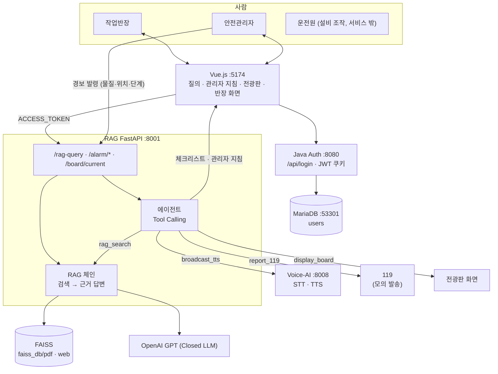

# HeartSignal - 프로젝트 기획서

# 1. 소개

### 정유·석유화학 현장 비상상황 대응 에이전트 — 전광판 안내 · 관리자 대응 지침

현장에 **비상상황(가스 누출·화재·노출)이 발생해 경보가 발령되면**, **에이전트는 사람이 하기 어려운 "찾기·정리·안내·연락" 업무(전광판 대피 안내, 관리자 대응 지침, 구역 방송, 작업반장용 체크리스트, 119 신고 정보)를 문서 근거와 함께 대신 수행**합니다. **사람은 경보 발령·대피 지휘·설비 조작·현장 판단**에 집중합니다.

> 센서·농도값 같은 가상 데이터는 쓰지 않습니다. 시작점은 **안전관리자의 경보 발령 입력(물질·위치·단계)**이며, 발표·시연은 **3단계 상황을 가정**합니다.

# 2. 업무 맥락 — 누가, 어떤 상황에서, 무엇을 찾다가 막히는가

## 2.1 사용자

| 사용자                                        | 하는 일                                    | JWT role                         |
| --------------------------------------------- | ------------------------------------------ | -------------------------------- |
| **현장 작업반장** (협력사 정비팀·출하팀 반장) | 작업 지휘, 경보 시 **대피 지시·인원 점검** | `foreman`                        |
| **현장 작업자** (신입 운전원·협력사 작업자)   | 작업 수행, 작업 전 안전 질문               | `worker`                         |
| **안전관리자** (관제실)                       | **경보 발령**, 비상조치 가동, 대외 연락 책임 | `admin`                          |
| **운전원** (DCS 조작)                         | 차단밸브·비상정지(ESD) 등 **설비 조작**    | 서비스 사용자 아님 (역할만 명시) |

## 2.2 업무 장면과 막히는 지점

| #   | 누가                 | 업무 상황                                        | 무엇을 찾다가                                                        | 어디서 막히나                                                                                                                 | HeartSignal 연결                                                                                                    |
| --- | -------------------- | ------------------------------------------------ | -------------------------------------------------------------------- | ----------------------------------------------------------------------------------------------------------------------------- | ------------------------------------------------------------------------------------------------------------------- |
| W1  | 출하팀 작업반장      | 탱크로리 프로판 출하 중 가스 경보                | "출하를 멈춰야 하나? 차량 시동은? 다시 재개하는 조건은?"             | 절차가 KOSHA G-78 10.2에 있지만 현장에서 문서를 펼 수 없음. 동시에 **대피 지시와 119·인근 공장 연락**을 해야 해서 손이 모자람 | 에이전트가 **전광판 대피 문구·119 신고 정보를 정리**하고, 반장 단말에 G-78 근거 **체크리스트**를 띄움. 반장은 대피·인원 점검만 |
| W2  | 정비팀 작업반장      | 정기보수 중 증류탑 맨홀 개방 작업 전 | "황화철 자연발화 징후인가? 물을 얼마나 뿌려? 출입구 다 열어도 되나?" | P-64(황화철) 지침을 아는 사람이 드묾. 안전지침 PDF(이산화황)는 대부분 "자료없음"                                              | 작업 전 **RAG 질의**로 P-64 근거 체크리스트 제공                                             |
| W3  | 밀폐공간 진입 작업자 | 탱크 내부 진입 전 산소·황화수소 측정             | "산소 몇 %부터 들어가면 안 돼? 황화수소 몇 ppm까지 돼?"              | 기준이 안전보건규칙 제618조·노출기준 고시에 흩어져 있음. 용어(H2S·황화수소) 혼용                                              | 작업 전 **RAG 질의**로 기준 + 조문 출처 답변                                                                        |
| W4  | 안전관리자           | 3단계 경보, 119 신고                             | "물질명·UN번호·CAS·농도·위치·이격거리를 정리해서 말해야 함"          | 신고 정보가 MSDS·안전지침·관제 화면에 흩어짐. 신고 중에는 현장 지휘 불가                                                      | 에이전트가 **관리자가 입력한 상황(물질·위치) + 안전지침 PDF 기본정보**로 신고문 작성·발송 (관리자 보류 가능)                     |
| W5  | 안전관리자           | 독성가스 누출, 현장 대피 안내                    | "바람 방향 몇 m까지 위험? 작업자들에게 어떻게 알려?"                 | 초기이격거리가 물질마다 다르고, 방송·안내 문구를 즉석에서 만들어야 함                                                          | 에이전트가 안전지침 **초기이격거리** 근거로 **전광판 접근금지·대피 문구**와 **관리자 대응 지침 카드**를 작성         |
| W6  | 현장 작업자          | 전광판에 "반경 30m 접근 금지" 표시               | "왜 30m야? 어느 쪽으로 피해야 해?"                                  | 안내 문구의 근거를 모름                                                                                                       | 전광판·지침 카드에 **근거 출처**를 함께 표시하고, 질의 화면에서 쉬운 말로 설명                                      |

> **핵심 통찰:** 경보 상황에서 사람이 막히는 이유는 "지식 부족"보다 **찾고·정리하고·연락하는 일과 대피 지휘가 같은 시간에 몰리는 것**입니다. 그래서 에이전트는 **찾기·정리·연락**을 맡고, 사람은 **사람만 할 수 있는 일(대피 지휘·설비 조작·현장 판단)**을 맡습니다.

# 3. 단계별 대응 — 사람과 에이전트의 역할 분리 ⭐

## 3.1 원칙

| 누가                              | 하는 일                                                                                                  | 절대 하지 않는 일                                    |
| --------------------------------- | -------------------------------------------------------------------------------------------------------- | ---------------------------------------------------- |
| **경보 발령 (안전관리자)**        | 비상상황(물질·위치·단계)을 입력해 대응 시작                                                              | 문구 생성                                            |
| **에이전트 (RAG + Tool Calling)** | 문서 검색 → 전광판 문구·관리자 지침·방송 문구·체크리스트·신고문 작성 → **전광판 표시, 구역 방송, 담당자 알림, 119 신고 실행** | 경보 단계 판정·해제, 대피 판단, 설비 조작, 의료 판단 |
| **작업반장**                      | 작업 중지·**대피 지시·인원 점검**, 현장 재측정                                                           | 신고·대외 연락 (에이전트가 대신)                     |
| **안전관리자**                    | 비상조치 가동, **119 신고 보류(30초 내)**, **경보 해제**, 재개 승인                                      | —                                                    |
| **운전원**                        | 차단밸브·ESD 등 설비 조작                                                                                | —                                                    |

- 에이전트가 쓰는 **모든 대응 문장은 `rag_search` 결과 문서에서 가져오고 출처를 붙입니다.** 근거가 없으면 해당 문장을 빼고, 고정 템플릿 문구만 씁니다.
- **LLM 장애 시에도** 고정 템플릿으로 전광판·방송·신고·알림은 동작합니다. (에이전트가 없어도 경보는 멈추지 않음)

## 3.2 단계별 역할표

| 단계          | 단계 기준 (참고)                                     | 🤖 에이전트가 하는 일 (도구)                                                                                                                                                                                                                                                                                        | 👷 작업반장                                                   | 🧑‍💼 안전관리자                                  | 🔧 운전원             |
| ------------- | ---------------------------------------------------- | ------------------------------------------------------------------------------------------------------------------------------------------------------------------------------------------------------------------------------------------------------------------------------------------------------------------- | ------------------------------------------------------------- | ---------------------------------------------- | --------------------- |
| 🟡 **1 주의** | TWA 초과 또는 5분 연속 상승 추세                     | ① `rag_search`로 물질·작업 상황 대응 문서 검색 ② `broadcast_tts` 해당 구역 **주의 방송** ③ `notify_foreman` 반장 단말에 **점검 체크리스트**(재측정·점화원 확인) ④ `notify_manager` 관리자 **대응 지침 카드**                                                                                                                        | 휴대용 검지기로 **재측정**, 작업 계속/일시중지 판단           | 관제 화면 확인                                 | 공정 이상 여부 확인   |
| 🟠 **2 경고** | 공식 1차 경보 (LEL 25%, P-136 경보값, 산소 18% 미만) | ① `broadcast_tts` **작업 중지·점화원 제거·대피 준비** 방송 (문서 근거) ② `notify_foreman` **대피 경로·집결지·인원 명단** 체크리스트 ③ `notify_manager` 비상조치 가동 요청 ④ `display_board` 전광판에 **작업 중지·대피 준비** 문구                                                                                                          | **작업 중지 지시**, 보호구 착용, **대피 지시·인원 점검** 시작 | 비상조치계획 가동 판단, 출하 중단 지시         | 차단밸브 준비         |
| 🔴 **3 위험** | IDLH 또는 LEL 50%                                    | ① `report_119` **119 신고문 작성 → 30초 보류창 → 발송** (물질·UN·CAS·위치·인원 현황) ② `display_board` 전광판에 **대피 방향·접근금지 반경(초기이격거리)** 표시 + `notify_manager` 관리자 **대응 지침 카드** ③ `broadcast_tts` **전 구역 대피 방송** ④ `build_briefing` 소방 도착 시 **브리핑 카드**(MSDS 요약) ⑤ 반장이 입력한 **인원 점검 결과를 119 후속 보고에 반영** | **대피 유도, 인원 점검 결과 입력**("12/12 확인")              | **신고 보류(오경보 시)**, 현장 지휘, 소방 인계 | **ESD·차단밸브 조작** |
| ⬜ **해제**   | 자동 해제 없음 (관리자만 해제)                      | `broadcast_tts`·`display_board` 해제 안내, 감사 로그 마감, 재개 조건 체크리스트(문서 근거) 제공                                                                                                                                                                                                                                     | 재측정 결과 보고                                              | **경보 해제·작업 재개 승인**                   | 설비 정상화           |

> 단계는 **안전관리자가 발령**합니다. "단계 기준" 열은 각 단계의 의미를 설명하는 참고 근거이며, 센서·자동 판정은 없습니다. 발표·시연은 **3단계 상황을 가정**합니다.

## 3.3 에이전트 도구 명세

| 도구               | 입력                                                 | 출력                                   | 근거 자료                                        | 단계       |
| ------------------ | ---------------------------------------------------- | -------------------------------------- | ------------------------------------------------ | ---------- |
| `rag_search`       | 물질, 상황(`leak`/`fire`/`confined`/`loading`), 질문 | 청크 + 출처                            | 전체 인덱스                                      | 1·2·3·해제 |
| `broadcast_tts`    | 구역, 문구, 반복 횟수                                | 방송 ID                                | rag_search 결과                                  | 1·2·3·해제 |
| `notify_foreman`   | 구역, 체크리스트                                     | 알림 ID                                | KOSHA GUIDE                                      | 1·2·3      |
| `notify_manager`   | 물질, 상황, 구역                                     | **관리자 대응 지침 카드** (즉시 조치·보호구·응급조치·119 신고 정보 + 출처) | 안전지침 PDF 누출 대처·응급조치·기본 물질 정보 | 1·2·3      |
| `report_119`       | 물질, 구역, 시각, 인원 현황                          | 신고 ID, 상태(`pending`/`held`/`sent`) | 안전지침 PDF 기본 물질 정보(UN·CAS·GHS)          | 3          |
| `display_board`    | 구역, 물질, 상황                                     | **전광판 문구**(3~4줄) + 출처 1줄      | 안전지침 PDF 초기이격거리·누출 시 대처요령       | 2·3·해제   |
| `build_briefing`   | 경보 ID                                              | 브리핑 카드                            | 안전지침 PDF 응급조치·누출 대처                  | 3          |

---

# 4. 핵심 질문 10개와 근거 자료

> 상태: ✅ 레포 보유 · 📥 확보 필요(원문 URL·팀 보유본) · ⚠️ 레포 PDF가 "자료없음" → 대체 자료 필요

| #   | 업무 장면 | 질문 (사용자 말투)                             | 기대 답 (원문 재확인 필요)                                                                    | 근거 자료 · 위치                                                          | 상태                                     | 사용처                    |
| --- | --------- | ---------------------------------------------- | --------------------------------------------------------------------------------------------- | ------------------------------------------------------------------------- | ---------------------------------------- | ------------------------- |
| Q1  | W1        | 출하 중에 프로판이 새면 뭐부터 해?             | 출하 중단, 운행 중인 전 차량·내연기관 시동 끄기, 점화원 제거, 가스 감지기로 농도 확인 후 재개 | KOSHA GUIDE G-78-2021 10.2(13)(14)                                        | 📥 (`안전지침/프로판.pdf`는 ⚠️ 자료없음) | 2단계 방송·체크리스트     |
| Q2  | W6        | LEL 25%가 뭐야? 프로판이면 몇 %vol?            | 폭발하한의 25% = 1차 경보. 프로판 LEL 2.0%vol → 0.5%vol                                       | KOSHA P-135(인화성 가스누출감지경보기, 최신 번호 확인)                    | 📥                                       | RAG 질의                  |
| Q3  | W3        | 황화수소 노출기준이 몇 ppm이야? (H2S로 물어도) | TWA 10ppm, STEL 15ppm                                                                         | 화학물질 및 물리적 인자의 노출기준 별표1 (고용노동부고시, 최신 개정 확인) | 📥 (`안전지침/황화수소.pdf`는 ⚠️)        | RAG 질의                  |
| Q4  | W3        | 밀폐공간 들어가도 되는 공기 기준은?            | 산소 18% 이상 23.5% 미만, 탄산가스 1.5% 미만, 일산화탄소 30ppm 미만, 황화수소 10ppm 미만      | 산업안전보건기준에 관한 규칙 제618조 (국가법령정보센터, WEB)              | 📥                                       | RAG 질의                  |
| Q5  | W2        | 증류탑 열 때 황화철 때문에 뭘 모니터링해?      | 탑·탱크 상부에서 이산화황·일산화탄소·이산화탄소                                               | KOSHA GUIDE P-64-2012 5.3.2(6)                                            | 📥 (`안전지침/이산화황.pdf`는 ⚠️)        | 체크리스트                |
| Q6  | W2        | 황화철에 물은 얼마나 뿌려?                     | 최소 2시간 이상, 10~15㎥/㎡ 이상                                                              | KOSHA GUIDE P-64-2012 5.2.1(2)                                            | 📥                                       | 체크리스트                |
| Q7  | W5        | 암모니아 새면 몇 m까지 사람을 빼야 해?         | 소규모 누출 반경 30m (초기이격거리)                                                           | `안전지침/암모니아.pdf` — 누출 시 대처요령 > 초기이격거리                 | ✅                                       | `display_board` 접근금지 반경   |
| Q8  | W4        | 119에 염소 누출 신고할 때 뭘 알려줘야 해?      | 물질명, CAS 7782-50-5, UN번호, GHS 위험성, 위치·인원                                     | `안전지침/염소.pdf` — 기본 물질 정보·GHS 정보                             | ✅ (값은 적재 시 추출·검증)              | `report_119` 신고문       |
| Q9  | W4·W5     | 염소 들이마신 사람 응급조치는?                 | 신선한 공기, 산소 공급, 적절한 장비로 인공호흡, 보온·안정                                     | `안전지침/염소.pdf` — 응급조치 > 흡입                                     | ✅                                       | `build_briefing`, 방송    |
| Q10 | W1·해제   | 경보 꺼지면 바로 작업 재개해도 돼?             | 가스 감지기로 농도 확인 후 책임자 승인하에 재개 (자동 해제 아님)                              | KOSHA GUIDE G-78-2021 10.2(14), A-G-14-2026 7.2                           | 📥                                       | 해제 체크리스트           |

**handoff 테스트 (근거 없음 → LLM 미호출):** "3번 탱크 지금 압력 몇이야?"(실시간 설비) · "두통이 있는데 중독인가요?"(의료 판단) · "회사 휴가 규정 알려줘"(도메인 밖)

## 4.1 자료 공백과 대응

`안전지침/` 22종을 확인한 결과, 아래 물질은 핵심 항목이 거의 **자료없음**입니다.

| 물질                                                  | "자료없음" 수 | 데모 영향                                               | 대응                                                     |
| ----------------------------------------------------- | ------------- | ------------------------------------------------------- | -------------------------------------------------------- |
| 프로판, 수소, 메테인, 에틸렌, 아세틸렌, 부타디엔      | 39~49         | **S1(출하장 프로판)** 근거 없음                         | KOSHA G-78·P-135로 대체, CHEM-i에서 수동 재다운로드 시도 |
| 황화수소                                              | 48            | **S3(밀폐공간)** 물질 정보 없음 (UN1053·CAS·GHS만 있음) | 노출기준 고시 + 안전보건규칙 제618조 + KOSHA E-G-18      |
| 이산화황                                              | 51            | **S2(증류탑)** 근거 없음                                | KOSHA P-64                                               |
| 암모니아, 염소, 염화수소, 불산, 황산, 벤젠, 톨루엔 등 | 10~26         | 이격거리·응급조치 있음                                  | 그대로 사용 (Q7~Q9)                                      |

> 데이터 파이프라인은 **"자료없음" 항목을 청크에서 제거**하고, 물질별 보유 항목을 **데이터 출처표**에 기록합니다. 에이전트는 출처표에 없는 항목을 "확인된 자료 없음"으로 표시하고 문장을 지어내지 않습니다.

---

# 5. 범위

## 5.1 MVP (Day1~Day2)

- 로그인 → JWT → `/rag-query` 근거 답변 + 출처 (`needs_review`·`handoff`)
- 안전지침 PDF + KOSHA GUIDE + 법령 조문 적재 (FAISS)
- 안전관리자 **경보 발령**(`/alarm`: 물질·위치·단계) → 단계별 에이전트 대응
- 관리자 지침 화면(경보 발령·지침 카드·신고 상태), **전광판 화면**, 작업반장 화면(체크리스트·인원 점검 입력)

## 5.2 확장 (가산점, MVP E2E 후)

- 에이전트 Tool Calling (3.3 도구), 119 **모의 발송**
- 음성: STT → `/rag-query` → TTS, 경보 방송 TTS (`Voice-AI/` 재사용)

## 5.3 범위 밖

- 실제 119·문자 발송, **센서·농도값 기반 자동 판정(가상 데이터)**, 실물 설비 연동, 실시간 확산 시뮬레이션, 사내 MSDS, 의료 판단

---

# 6. 아키텍처



> **트레이드오프 한 줄:** 단계 발령과 해제는 사람이 맡고, 에이전트에는 **정리·안내·연락 업무의 실행 권한**을 주되 사람의 **보류·해제 권한**으로 통제한다.

---

# 7. 팀 작업 4개 파트

> 각 파트는 **베이스 코드 위에서 빈칸(TODO)을 채우고 최소한으로 확장**합니다. 파일 소유권·공통 계약은 `AGENTS.md` 참조.

## 7.1 데이터 파이프라인 — PDF·WEB 수집·정제 → 청킹·임베딩 → FAISS

| 항목        | 내용                                                                                                                                                                              |
| ----------- | --------------------------------------------------------------------------------------------------------------------------------------------------------------------------------- |
| 베이스 코드 | `RAG/rag_external-web_pdf_closed_llm.py` `/upload-paper`, `/upload-topic`, `load_paper()`                                                                                         |
| 수집        | PDF: `안전지침/` 22종 + KOSHA GUIDE(G-78, P-64, P-135, P-136, A-G-14, E-G-18) / WEB: 국가법령정보센터 조문(제618조·제232조), 노출기준 고시 별표1 — **수동 다운로드, 크롤링 금지** |
| 정제        | 인쇄 머리말(`26. 10. 22. 오후 4:56 about:blank`, `1/4`), KOSHA 반복 머리말·쪽번호, **"자료없음" 항목**, 링크 안내 문구 제거                                                       |
| 청킹        | 안전지침: **항목 단위**(누출 시 대처요령·응급조치·GHS 등) / KOSHA: 절·항 단위 / 법령: 조 단위. 기본 `chunk_size=1000, overlap=100`은 백업 규칙                                    |
| 메타데이터  | `source`, `section`, `doc_type`(`emergency`/`guide`/`law`), `substance`, `cas`, `published`                                                                                       |
| 할 일       | `FASISS` 오타 수정(Q02), 일괄 적재 스크립트 `RAG/scripts/ingest.py`, 데이터 출처표 작성                                                                                           |
| **산출물**  | 적재 스크립트, `RAG/faiss_db/` 인덱스, **데이터 출처표**(`docs/data_sources.md`: 문서·URL·공표일·적재 범위·물질별 보유 항목)                                                      |

## 7.2 RAG 서비스·LLM — 검색 → 근거 기반 답변, 프롬프트, Closed LLM 연동, 에이전트

| 항목        | 내용                                                                                                                                                                                                                                  |
| ----------- | ------------------------------------------------------------------------------------------------------------------------------------------------------------------------------------------------------------------------------------- |
| 베이스 코드 | `rag_query()`, `extract_by_marker()`, `ChatOpenAI(model="gpt-4o")`                                                                                                                                                                    |
| 할 일       | `similarity_search_with_socre` 오타 수정(Q04) · 동의어 사전(H2S→황화수소) · 질문 유형별 `doc_type` 필터 · 프롬프트(근거 블록만, 출처 필수, 없으면 N/A) · `needs_review`/`handoff` 판정 · 에이전트 도구(3.3) · LLM 장애 시 템플릿 폴백 |
| 평가        | 핵심 질문 10개 + 변형 10개 + handoff 3개 → 정확성·근거성·환각률·handoff 적중률. **한 번에 하나만 바꾸고 재측정**                                                                                                                      |
| **산출물**  | RAG 체인 코드, `RAG/prompts/`, 평가셋·**평가 결과(개선 전후 수치)** `docs/eval_results.md`                                                                                                                                            |

## 7.3 인증 연동·API — JWT 검증, `/rag-query` 스키마·오류 처리·로그

| 항목        | 내용                                                                                                                                                                                                                                                                                                                                                                 |
| ----------- | -------------------------------------------------------------------------------------------------------------------------------------------------------------------------------------------------------------------------------------------------------------------------------------------------------------------------------------------------------------------- |
| 베이스 코드 | `backend/.../SimpleAuthServer.java` (TODO ①~⑤-B), `Voice-AI/app/main.py` `get_current_user()` (Python JWT 검증 패턴)                                                                                                                                                                                                                                                 |
| 할 일       | Java TODO 채우기 · **`users.role` 컬럼 + JWT `role` 클레임 추가**(현재 없음, 최소 변경) · RAG에 JWT 의존성 이식(`ACCESS_TOKEN` 쿠키) · 비밀키 하드코딩(`RANDOM_SECRET_KEY`) → 환경변수 `JWT_SECRET` · `/rag-query` 응답 확장(아래) · 오류 코드 표준화 · 질문 원문 미저장 로그 미들웨어 · `/alarm/*`(경보 발령·상태·보류·해제) + `/board/current` |
| **산출물**  | API 명세(FastAPI Swagger `/docs`), 인증·로그 미들웨어, 인증·경보 테스트                                                                                                                                                                                                                                                                                              |

### `/rag-query` 계약 (베이스 필드 `prompt`·`response` 유지, 필드 추가만)

```json
// 요청 (베이스 그대로)
{ "prompt": "H2S 노출기준이 몇 ppm이야?", "source": "pdf", "top_k": 5 }
// 응답
{ "prompt": "H2S 노출기준이 몇 ppm이야?",
  "response": "황화수소 노출기준은 TWA 10ppm, STEL 15ppm입니다.",
  "sources": [{"source": "노출기준 고시 별표1", "section": "황화수소"}],
  "needs_review": false, "handoff": false,
  "request_id": "a1b2c3", "latency_ms": 2840 }
```

### 오류 응답

| 코드 | 상황                                        | 프론트 동작                        |
| ---- | ------------------------------------------- | ---------------------------------- |
| 401  | 토큰 없음·만료·서명 오류                    | 로그인 화면                        |
| 403  | role 불일치 (worker 업로드·경보 발령)        | "권한이 없습니다"                  |
| 422  | 스키마 오류 (빈 질문, 물질·구역 누락)       | 입력 안내                          |
| 503  | 인덱스 미준비·LLM 타임아웃                  | 재시도 안내 (**경보는 계속 동작**) |

모든 오류 본문: `{"error": {"code": "...", "message": "...", "request_id": "..."}}`

### 경보 API

| 메서드 | 경로                      | 권한                 | 용도                                                        |
| ------ | ------------------------- | -------------------- | ----------------------------------------------------------- |
| POST   | `/alarm`                  | admin                | `{zone, substance, stage, note}` → 경보 발령 + 에이전트 실행 |
| GET    | `/board/current`          | 전광판 화면          | 현재 표시 중인 문구·출처                                    |
| GET    | `/alarm/status`           | worker·foreman·admin | 구역별 단계·근거                                            |
| POST   | `/alarm/{id}/headcount`   | foreman              | 인원 점검 결과 입력                                         |
| POST   | `/alarm/{id}/hold-report` | admin                | 119 신고 보류 (30초 내)                                     |
| POST   | `/alarm/{id}/clear`       | admin                | 경보 해제                                                   |

## 7.4 프론트엔드·배포 — Vue.js 화면 도메인화, Docker Compose, README

| 항목        | 내용                                                                                                                                                                                                                                                       |
| ----------- | ---------------------------------------------------------------------------------------------------------------------------------------------------------------------------------------------------------------------------------------------------------- |
| 베이스 코드 | `external_index.html`·`internal_index.html` (Vue 3 CDN), `backend/.../web/login.html`, `db/docker-compose.yml`, `Voice-AI/docker-compose.yml`                                                                                                              |
| 할 일       | 범용 RAG 화면 → **HeartSignal 화면 4종**: ① 안전 질의(출처·handoff 안내) ② 관리자 지침(경보 발령 입력·지침 카드·방송 로그·신고 상태·보류 버튼) ③ **전광판**(큰 글씨 대피 문구·출처) ④ 작업반장(체크리스트·인원 점검 입력) · 비상 배너 · 401 → 로그인 · 루트 `docker-compose.yml`(db·auth·rag·voice·web) · README |
| **산출물**  | 화면, `docker-compose.yml`, `README.md`, **배포 URL**, 실행 영상                                                                                                                                                                                           |

## 7.5 역할 분담

| 파트                        | 담당자                                |
| --------------------------- | ------------------------------------- |
| 7.1 데이터 파이프라인       | 정순욱                                |
| 7.2 RAG 서비스·LLM·에이전트 | 심혁                                  |
| 7.3 인증 연동·API·경보 API | 김근홍                                |
| 7.4 프론트엔드·배포         | 허지원                                |
| STT-to-TTS·경보 방송        | 한유진 (+ 평가셋 질문 작성·발표 자료) |

## 7.6 파트 간 인터페이스

```
7.1 ──(faiss_db/, 메타데이터 스키마, data_sources.md)──▶ 7.2
7.2 ──(answer_with_sources(), agent.run(alarm))─────▶ 7.3 (라우터에서 호출)
7.3 ──(API 명세 /docs, 오류 형식, 쿠키 이름)─────────▶ 7.4
7.4 ──(compose 서비스 이름·포트·환경변수)────────────▶ 전체
```

---

# 8. 경보 단계 기준 (참고)

| 단계             | 독성가스                                                            | 가연성가스          | 산소                               |
| ---------------- | ------------------------------------------------------------------- | ------------------- | ---------------------------------- |
| 🟡 1 주의 (자체) | TWA 초과 또는 2단계 값 50%, 또는 5분 연속 상승                      | 5분 연속 상승       | 결정 필요                          |
| 🟠 2 경고 (공식) | KOSHA P-136 방식 경보값 = min(ERPG-2, AEGL-2 60분, PAC-2, IDLH×10%) | LEL 25% (P-135 1차) | 18% 미만 또는 23.5% 이상 (제618조) |
| 🔴 3 위험 (공식) | IDLH                                                                | LEL 50% (P-135 2차) | 결정 필요                          |

- 단계는 **안전관리자가 발령**하며, 위 기준은 각 단계의 의미를 설명하는 **참고 근거**입니다. 센서·`thresholds.json`·자동 판정은 사용하지 않습니다.
- 발표·시연은 **3단계 상황을 가정**합니다. 기준 수치를 RAG 답변으로 설명할 때는 P-135·P-136 최신 번호와 노출기준 고시 최신 개정을 확인합니다.

---

# 9. 데모 시나리오

| #     | 장면                 | 관리자 입력 (경보 발령)                | 단계  | 에이전트가 한 일                                                                                    | 사람이 한 일                                                      | 근거              |
| ----- | -------------------- | -------------------------------------- | ----- | --------------------------------------------------------------------------------------------------- | ----------------------------------------------------------------- | ----------------- |
| S1 ⭐ | 출하장 프로판 누출   | 출하장 프로판 누출 · 3단계             | 3     | **전광판 대피 문구**·출하 중단·시동 끄기 방송, 반장 체크리스트, **관리자 대응 지침 카드**, **119 신고(모의)** | 반장: 대피·인원 점검 입력 / 관리자: 보류 안 함 / 운전원: 차단밸브 | G-78 10.2, P-135  |
| S2    | 증류탑 개방 (황화철) | 증류탑 개방 중 이상 징후 · 2단계       | 2     | 점검 방송, 모니터링 가스·살수 체크리스트                                                          | 반장: 출입구 동시 개방 중지, 살수 지시                            | P-64 5.2.1, 5.3.2 |
| S3    | 밀폐공간 진입 전     | 밀폐공간 진입 전 공기 이상 · 2단계     | 2     | 진입 금지 방송, 적정공기 기준·보호구 안내                                                           | 반장: 진입 중지, 환기 지시                                        | 제618조, E-G-18   |

---

# 10. 테스트·완료 기준

- **인증:** 무토큰 401, worker 업로드·경보 발령 403
- **RAG:** 핵심 질문 10개 정답·출처 일치, handoff 3개 적중, 개선 전후 수치 기록
- **경보:** 관리자 발령 시 단계별 에이전트 실행, 자동 해제 안 됨, LLM 차단 상태에서 S1 고정 템플릿 동작, 전광판 문구에 출처 표시
- **에이전트 경계:** 에이전트가 경보 발령·해제 API를 호출할 수 없음, 보류된 신고는 발송되지 않음, 모든 방송 문구에 출처 존재
- **배포:** `docker compose up` 한 번으로 전체 기동, README대로 신규 PC 재현

팀원 전원이 본인 파트와 **"왜 발령·해제는 사람, 정리·안내·연락은 에이전트, 대피는 사람인가"**를 설명할 수 있으면 완료입니다.

---

# 11. 위험과 대응

| 위험                          | 대응                                                                                |
| ----------------------------- | ----------------------------------------------------------------------------------- |
| 에이전트의 잘못된 안내·신고    | 문서 근거만 사용, 전광판·지침 카드에 출처 표시, 119 신고 관리자 30초 보류            |
| LLM이 응급조치·수치를 지어냄  | 근거 블록만 사용, 출처 필수, "자료없음" 항목은 적재하지 않음                        |
| 레포 PDF 자료 공백 (4.1)      | KOSHA GUIDE·법령으로 대체, 출처표에 공백 기록                                       |
| 에이전트가 사람 역할 침범     | 도구 목록에 발령·해제·설비 조작 도구 없음 (코드로 강제)                             |
| JWT에 role 없음 (현재 베이스) | `users.role` + 클레임 추가, 없으면 `worker`로 간주                                  |
| CORS `"*"` + credentials 조합 | 허용 origin 명시로 교체                                                             |

---

# 12. 구현 전 결정 사항

| 항목                | 제안                                                  | 상태         |
| ------------------- | ----------------------------------------------------- | ------------ |
| 119 신고 방식       | 에이전트 실행 + 관리자 30초 보류                      | 팀 확인 필요 |
| 전광판 문구 형식    | 3~4줄 행동 문구 + 출처 1줄                            | 팀 확인 필요 |
| 임베딩              | 베이스대로 `OpenAIEmbeddings` (변경 시 인덱스 재생성) | 제안         |
| 프론트              | Vue 3 CDN 단일 HTML 유지 vs Vite 전환                 | 팀 확인 필요 |

---

# 13. 일정

- **Day 1:** 기획 확정(체크포인트①) · Java TODO + JWT role · RAG 오타 수정 → 로그인→`/rag-query` 1회 성공(체크포인트②) · 자료 수동 다운로드
- **Day 2:** 정제·청킹·적재 · 프롬프트·handoff · JWT 미들웨어·Swagger(체크포인트③) · `/alarm` 발령 API·전광판 화면 · 화면 E2E(체크포인트④) · 에이전트 도구
- **Day 3:** 평가·개선 루프 · Compose 배포 · 운영 점검(체크포인트⑤) · S1 중심 발표
