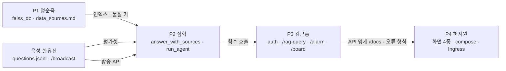

# HeartSignal - 구현 명세서

> 기준 문서: [`HeartSignal-Plan.md`](HeartSignal-Plan.md)(기획서), [`../AGENTS.md`](../AGENTS.md)(공통 규칙), [`k8s-deploy-guide.md`](k8s-deploy-guide.md)(배포)
> 기준 시점: 2026-10-23 오전, `main` = `10887a4` (PR #1~#5 병합 후)
> 기획서가 **무엇을·왜**라면, 이 문서는 **누가·어떤 입출력으로·언제까지·어떻게 확인하는지**를 정합니다. 둘이 다르면 기획서가 우선이고, 이 문서를 고칩니다.

---

# 1. 팀과 담당

| 파트 | 담당 | 소유 경로 (AGENTS.md 4장) | 한 줄 책임 |
| --- | --- | --- | --- |
| **P1 데이터** | 정순욱 | `안전지침/`, `RAG/scripts/`, `RAG/faiss_db/`, `RAG/data/`, `docs/data_sources.md` | 근거 문서를 모아 깨끗한 청크로 FAISS에 넣는다 |
| **P2 RAG·LLM·에이전트** | 심혁 | `RAG/rag_external-web_pdf_closed_llm.py`의 검색·답변 로직, `RAG/prompts/`, `RAG/agent/`, `RAG/eval/`, `docs/eval_results.md` | 근거 있는 답변과 경보 대응 문구를 만든다 |
| **P3 인증·API** | 김근홍 | `backend/`, `db/`, `RAG/auth.py`, `RAG/middleware.py`, `RAG/alarm/` | 누가 무엇을 할 수 있는지 막고, 경보 API를 연다 |
| **P4 프론트·배포** | 허지원 | `*.html`(루트), `web/`, 루트 `docker-compose.yml`, `README.md`, Ingress | 화면 4종과 배포를 맡는다 |
| **음성** | 한유진 | `Voice-AI/` | 경보 방송 TTS, 평가셋 질문 작성, 발표 자료 |

---

# 2. 현재 진행 현황 (2026-10-23 15:20, `main` `5249268`)

> 근거는 `git log`·열린 PR·클러스터 상태(`kubectl get pods -n class-4`)입니다. 로컬 미푸시 작업은 반영되지 않았으니 다르면 고쳐 주세요.

| 파트 | 완료 | 남은 핵심 | 주의 |
| --- | --- | --- | --- |
| P1 정순욱 | 보완 원문 18종(G-78·P-64·E-G-18·법령·노출기준·MSDS) + 안전지침 22종 → **정식 인덱스 40문서·2,836청크**(항목 단위, `source`·`section`·`substance`·`cas`, #13), 적재 스크립트, 출처표 | `test_ingest` 1건 pdftotext 없는 환경 skip 처리, 안전지침 22개 원문 URL·공표일 | P-135는 미보유 → 평가셋 Q2 기대 출처를 프로판 MSDS로 변경(팀 확인) |
| P2 심혁 | 평가 체계(핵심 10·변형 10·handoff 3, `eval_results.md` 0~16행, 3회 평균) · `/rag-query` 출처·handoff·게이트·인용·needs_review · 정식 인덱스 연결 · 물질 필터·법령 인덱스·검색어 재작성·BM25 하이브리드 · 경보 에이전트(도구 7개·고정 순서·메타데이터 근거) · LLM 키 없이 기동 · 챗봇 화면 출처 표시(#20) — **정확성 20→80%, 근거성 0→90%, 무근거 50→0%, handoff 3/3, 변형 57%** | rag 이미지 1.1.0 빌드·push·클러스터 배포(진행 중), 평가 최종 요약 | 남은 오답 Q8(도구 영역)·Q10(검색 의미). 어휘표는 평가셋 표현 기준이라 변형에서 57% |
| P3 김근홍 | Java TODO·`role`·시드 계정·환경변수화 · RAG JWT 검증·표준 오류·요청 로그 미들웨어(#7) · 경보 API 7개·119 보류 타이머·에이전트 브리지(#10) · **클러스터 배포: db·auth Running**(가이드 8.1) | 시드 계정 실제 로그인→쿠키→챗봇 확인(② 완전판), PR #3 소스 분리 유지 여부(AGENTS.md 8장) | — |
| P4 허지원 | Vue+Vite 화면 3종(로그인·홈·챗봇, #11) · web 이미지·Ingress·공통 Secret·ConfigMap 적용(#27) · **클러스터 배포: web Running** · Vite 포트 5174(#24) | 관리자·전광판·작업반장 화면(확장), README(현재 2줄), Ingress `/alarm`·`/board` 경로, 배포 URL 접속·TLS 확인 | 화면 3종은 P2가 명세서대로 초안을 만들어 P4 리뷰로 올리는 안 제안 중 |
| 음성 한유진 | `JWT_SECRET` 환경변수(#8), 평가셋 변형 질문 10개 | 발표 자료, voice 배포(선택), `/broadcast`(확장) | CUDA torch 이미지 3.49GB |

**체크포인트:** ① ✅ · ② ✅(Java 토큰으로 `/rag-query` 성공, 시드 계정 실제 로그인 경로는 P3 확인 중) · ③ ✅(무토큰 401, #7) · ④ ✅(화면에서 질문→답변+출처, `docs/screenshots/`) · ⑤ 진행 중(클러스터 db·auth·web Running, rag 배포 중, README·배포 URL 미완)

---

# 3. 공통 계약 (AGENTS.md 7장 요약 + 이 문서에서 새로 정하는 값)

## 3.1 이름 규칙

| 대상 | 값 | 비고 |
| --- | --- | --- |
| 물질 키 `substance` | `propane`, `hydrogen_sulfide`, `sulfur_dioxide`, `ammonia`, `chlorine`, … (영문 snake_case) | P1 메타데이터, P3 경보 입력, P2 검색 필터가 **같은 문자열**을 씁니다. 목록은 P1이 `docs/data_sources.md`에 확정 |
| 구역 키 `zone` | `loading_bay`(출하장), `distillation`(증류탑), `confined_tank`(밀폐공간·탱크) | 시연 S1~S3에 대응. 화면 표시명은 P4가 매핑 |
| 단계 `stage` | `1`(주의) · `2`(경고) · `3`(위험) | 정수. 해제는 단계가 아니라 `status: "cleared"` |
| 역할 `role` | `worker` · `foreman` · `admin` | `device` 없음. 클레임이 없거나 모르는 값이면 `worker` |
| 상황 `situation` | `leak` · `fire` · `confined` · `loading` | `rag_search` 입력 (기획서 3.3) |

## 3.2 서비스·포트·환경변수

| 서비스 | 로컬 포트 | compose 이름 | k8s Service | 필요한 환경변수 |
| --- | --- | --- | --- | --- |
| web | 5174 | `web` | `heartsignal-web:80` | API base URL 1개 |
| auth | 8080 | `auth` | `heartsignal-auth:8080` | `DB_URL`, `DB_PASSWORD`, `JWT_SECRET` |
| rag | 8001 | `rag` | `heartsignal-rag:8001` | `OPENAI_API_KEY`, `JWT_SECRET`, `JWT_ISSUER`, `CORS_ORIGINS`, `LLM_MODEL`, `LLM_TIMEOUT_S`, `VOICE_URL` |
| voice | 8008 | `voice` | `heartsignal-voice:8008` | `JWT_SECRET` |
| db | 53301→3306 | `db` | `heartsignal-db:3306` | `DB_PASSWORD` |

- `VOICE_URL`은 이 문서에서 새로 정합니다. rag가 방송 요청을 보낼 voice 주소입니다(compose `http://voice:8008`, k8s `http://heartsignal-voice:8008`). AGENTS.md 6장 표와 `.env-example`에 함께 추가합니다.
- 비밀값은 `.env`와 k8s Secret에만 둡니다. 코드에 기본값 비밀번호를 두지 않습니다.

## 3.3 JWT · 오류 · 출처 · 로그

- **JWT:** HS256, `iss=simple-auth-server`, `sub`, `username`, `role`, `exp`=1시간, 쿠키 `ACCESS_TOKEN`. Python 서비스는 각자 서명·만료·발급자를 검증하고 회원 DB에 접근하지 않습니다.
- **오류 본문:** `{"error": {"code": "...", "message": "...", "request_id": "..."}}`
  - 401 `UNAUTHORIZED`: 토큰 없음·만료·서명 오류
  - 403 `FORBIDDEN`: 권한 없음
  - 422 `VALIDATION_ERROR`: 입력 오류
  - 503 `NOT_READY` / `LLM_TIMEOUT`: 인덱스 준비 안 됨, LLM 응답 지연
  - 500 `INTERNAL`: 그 외
- **출처:** `{"source": "KOSHA GUIDE G-78-2021", "section": "10.2(13)"}` 객체 배열. 화면에는 `source section`으로 표시합니다.
- **로그:** JSON 한 줄. 질문 원문은 남기지 않고 `prompt_len`과 해시만 남깁니다. 경보 감사 로그 필드는 `alarm_id`, `zone`, `substance`, `stage`, `tool`, `tool_result`, `actor`(`agent`|사람 sub)입니다.

---

# 4. API 명세

## 4.1 `/rag-query` (rag, P2 로직 + P3 인증)

| 항목 | 값 |
| --- | --- |
| 권한 | 로그인한 모든 역할 (토큰 없으면 401) |
| 요청 | `{"prompt": str(1~500자), "source": "pdf"\|"web", "top_k": int(1~10, 기본 5)}`. 베이스 그대로 |
| 응답 | 베이스 필드 `prompt`, `response`를 유지하고 필드만 추가 |

```json
{
  "prompt": "H2S 노출기준이 몇 ppm이야?",
  "response": "황화수소 노출기준은 TWA 10ppm, STEL 15ppm입니다.",
  "sources": [{"source": "노출기준 고시 별표1", "section": "황화수소"}],
  "needs_review": false,
  "handoff": false,
  "request_id": "a1b2c3",
  "latency_ms": 2840
}
```

| 필드 | 규칙 |
| --- | --- |
| `handoff` | 검색 근거 0건, 또는 거리 점수가 임계값을 넘으면 `true`. **이때 LLM을 부르지 않고** "확인된 자료가 없습니다. 안전관리자에게 문의하세요." 고정 문구를 반환합니다 |
| `needs_review` | 사람 확인 권장. 답변의 숫자가 근거 블록에도 질문에도 없으면(근거 밖 수치·LLM이 계산한 파생 수치, 예: "0.525%vol") `true`, 또는 LLM이 `[문서 n]` 인용을 하나도 달지 않아 어느 근거를 썼는지 불명하면 `true`. ※ 처음 안("출처 1건뿐이면 true")은 출처를 인용 청크로 좁힌 뒤 정답 대부분이 1건이라 폐기 (평가 14행) |
| `sources` | `handoff=true`면 빈 배열. 그 외에는 1건 이상이어야 합니다 |
| 임계값 | P2가 평가셋으로 정해 `docs/eval_results.md`에 기록 |

## 4.2 경보 API (rag 안의 `RAG/alarm/` 라우터, P3)

| 메서드 | 경로 | 권한 | 요청 | 응답 |
| --- | --- | --- | --- | --- |
| POST | `/alarm` | `admin` | `{zone, substance, stage, note?}` | `201` 경보 객체. 에이전트는 백그라운드로 실행 |
| GET | `/alarm/status` | 로그인 사용자 | — | `{"alarms": [경보 객체]}`. 진행 중인 것만 |
| GET | `/alarm/{id}` | 로그인 사용자 | — | 경보 객체 (에이전트 실행 기록 포함) |
| POST | `/alarm/{id}/headcount` | `foreman` | `{checked: int, total: int}` | 경보 객체. 3단계면 119 후속 보고에 반영 |
| POST | `/alarm/{id}/hold-report` | `admin` | — | `report.status`를 `held`로. 이미 `sent`면 `409` |
| POST | `/alarm/{id}/clear` | `admin` | `{note?}` | `status: "cleared"`. 해제 방송과 전광판 해제 문구 실행 |
| GET | `/board/current` | 없음 (전광판 화면용) | `?zone=` (생략 시 전체) | `{"zone", "lines": [str], "source": {...}, "stage", "status", "alarm_id", "updated_at"}`. 진행 중 경보 중 가장 높은 단계. 해제 후 60초는 해제 문구, 경보가 없으면 `lines: []` |

**경보 객체**

```json
{
  "alarm_id": "al-20261023-0001",
  "zone": "loading_bay",
  "substance": "propane",
  "stage": 3,
  "note": "3번 출하대 탱크로리",
  "status": "active",
  "issued_by": "17",
  "issued_at": "2026-10-23T14:02:11+09:00",
  "cleared_by": null,
  "cleared_at": null,
  "board": {"lines": ["프로판 누출 — 출하장 접근 금지", "차량 시동을 즉시 끄세요", "바람 반대 방향 B 집결지로 대피"], "source": {"source": "KOSHA GUIDE G-78-2021", "section": "10.2(13)"}},
  "guide_card": {"immediate": [], "ppe": [], "first_aid": [], "report_info": {}, "sources": []},
  "checklist": [{"item": "출하 중단", "source": {"source": "...", "section": "..."}}],
  "briefing": null,
  "report": {"report_id": "r-0001", "status": "pending", "send_at": "2026-10-23T14:02:41.000+09:00",
             "text": "[모의 119 신고] ...", "sources": [], "headcount": "12/12", "followups": []},
  "headcount": {"checked": 0, "total": 0},
  "actions": [{"tool": "display_board", "ok": true, "fallback": false, "ts": "...", "sources": [...]}]
}
```

- **저장소:** 메모리 dict (`alarm_id` → 객체)를 씁니다. 서버를 재시작하면 경보가 사라지며, 시연 범위에서 허용합니다.
- **119 보류:** `report.status`는 `pending`으로 시작하고, `send_at`(발령 + 30초)이 되면 `sent`로 바뀝니다(모의 발송 = 로그 + 화면 표시). 그 전에 `hold-report`가 오면 `held`가 되고 **다시는 발송되지 않습니다.** 신고는 3단계에서만 만들어집니다(1·2단계는 `report: null`, 보류 요청 시 `409`).
- **인원 점검:** `report.headcount`에 반영합니다. 이미 `sent`면 `report.followups`에 후속 보고로 덧붙입니다.
- **해제:** 아직 발송되지 않은 신고는 `held`로 바꿉니다. 해제 후 60초 동안 전광판에 해제 문구를 표시합니다.
- **같은 구역 재발령:** 이전 경보를 자동으로 닫지 않습니다. 관리자가 직접 해제합니다("사람만 해제" 원칙). 전광판은 가장 높은 단계를 표시합니다.
- **경계:** 에이전트 코드는 `/alarm`, `/alarm/{id}/clear`, `stage`를 바꾸는 함수를 호출하지 않습니다(AGENTS.md 절대 규칙 1).

---

# 5. 에이전트 명세 (P2, `RAG/agent/`)

## 5.1 진입점 (P2 → P3 인터페이스)

```python
def answer_with_sources(prompt: str, source: str = "pdf", top_k: int = 5) -> dict   # /rag-query 응답 dict
async def run_agent(alarm: dict) -> list[dict]                                     # 실행한 도구 기록(actions)
```

P3 라우터는 `POST /alarm`에서 경보 객체를 만든 뒤 `run_agent(alarm)`을 백그라운드로 호출합니다. 해제(`POST /alarm/{id}/clear`) 뒤에도 같은 함수를 `alarm["status"] == "cleared"`인 경보로 한 번 더 호출합니다(해제 방송·재개 체크리스트).

- `alarm`은 **사본**입니다. 에이전트가 고쳐도 저장소에는 반영되지 않습니다.
- 반환하는 실행 기록 한 건의 형태:

```python
{"tool": "display_board", "ok": True, "fallback": False, "ts": "...",
 "sources": [{"source": "...", "section": "..."}],
 "output": ...}  # 도구별 아래 형태
```

| 도구 | `output` → 경보 객체 필드 |
| --- | --- |
| `display_board` | `{"lines": [str, ...(3~4줄)], "source": {"source", "section"} \| None}` → `board` (4줄 초과는 자름) |
| `notify_manager` | `{"immediate": [str], "ppe": [str], "first_aid": [str], "report_info": {...}, "sources": [...]}` → `guide_card` |
| `notify_foreman` | `{"checklist": [{"item": str, "source": {...} \| None}]}` → `checklist` |
| `report_119` | `{"text": str, "sources": [...]}` → `report.text`, `report.sources` (발송 여부는 바꾸지 않음) |
| `build_briefing` | `{"summary": [str], "first_aid": [str], "sources": [...]}` → `briefing` |

- `output` 본문은 각 필드에 들어가고, `actions`에는 `output`을 뺀 기록만 남습니다.
- **형태 검사:** `output` 형태가 위와 다르면 반영하지 않고 고정 문구를 유지하며, 그 기록을 `ok: false, fallback: true, reason: "bad_output"`으로 남깁니다. `stage`·`status`·`report.status`는 어떤 출력으로도 바뀌지 않습니다.
- **에이전트를 쓸 수 없을 때** `actions`의 `reason`: `agent_not_installed`(`RAG/agent/` 없음), `agent_import_failed`(패키지 안 import 오류, 서버 로그에 원인), `timeout`(`LLM_TIMEOUT_S × 3` 초과), 예외 이름(실행 중 오류).

## 5.2 단계별 실행 순서 (기획서 3.2)

| 단계 | 순서 |
| --- | --- |
| 1 | `rag_search` → `broadcast_tts`(주의) → `notify_foreman`(점검 체크리스트) → `notify_manager`(지침 카드) |
| 2 | `rag_search` → `broadcast_tts`(작업 중지·대피 준비) → `notify_foreman`(대피 경로·인원) → `notify_manager` → `display_board` |
| 3 | `rag_search` → `report_119`(30초 보류) → `display_board`(대피 방향·접근금지 반경) → `notify_manager` → `broadcast_tts`(전 구역 대피) → `build_briefing` |
| 해제 | `broadcast_tts`·`display_board` 해제 안내 → 재개 조건 체크리스트 |

## 5.3 도구 7개 (이 외의 도구는 만들지 않음)

| 도구 | 입력 | 출력 | 실패 시 |
| --- | --- | --- | --- |
| `rag_search` | `substance, situation, question` | `[{text, source, section, score}]` | 빈 배열 → 이후 도구는 템플릿 사용 |
| `broadcast_tts` | `zone, text, repeat` | `{broadcast_id}` | voice 장애 시 화면 방송 로그에만 남김 |
| `notify_foreman` | `zone, checklist[]` | `{notice_id}` | 템플릿 체크리스트 |
| `notify_manager` | `substance, situation, zone` | 지침 카드 `{immediate, ppe, first_aid, report_info, sources}` | 템플릿 카드 (`sources` 비움, "근거 확인 필요" 표시) |
| `report_119` | `substance, zone, time, headcount` | `{report_id, status, send_at}` | 템플릿 신고문 (물질명·위치·시각) |
| `display_board` | `zone, substance, situation` | `{lines[3~4], source}` | 단계별 고정 문구 |
| `build_briefing` | `alarm_id` | 브리핑 카드 (MSDS 요약·응급조치·출처) | 템플릿 카드 |

- **근거 규칙:** 대응 문장은 `rag_search` 결과에서만 가져오고 출처를 붙입니다. 근거가 없는 문장은 빼고 템플릿 문구만 씁니다.
- **LLM 장애 폴백:** LLM 호출이 `LLM_TIMEOUT_S`(20초)를 넘거나 실패하면 `RAG/prompts/templates/`의 단계별 고정 문구를 쓰고 `fallback: true`로 기록합니다. **경보·방송·신고·전광판은 LLM 없이도 동작해야 합니다.**
- **모의 발송:** `report_119`와 `broadcast_tts`는 외부로 보내지 않습니다. 로그를 남기고 화면에 표시하며, 방송만 voice TTS로 음성을 만듭니다.

---

# 6. 파트별 명세

> **우선순위**는 시연 S1(출하장 프로판 누출 · 3단계)을 끝까지 돌리는 데 필요한 순서입니다. **P0** = 체크포인트 통과에 필수, **P1** = MVP, **P2** = 가산점.
> ⚠️ 교재 기준(8.1)으로는 경보 에이전트 전체가 **확장(가산점)**입니다. 아래 표에서 경보 관련 P1 항목(경보 API, 관리자·전광판·작업반장 화면, 에이전트 도구)은 **④ 질문 → 답변 + 출처가 화면에서 동작한 뒤**에 진행합니다.

## 6.1 P1 데이터 — 정순욱

| 우선 | 작업 | 산출물 | 완료 확인 |
| --- | --- | --- | --- |
| P0 | KOSHA GUIDE G-78-2021(출하·누출), P-135, P-136, P-64, A-G-14, E-G-18 수동 다운로드. 산업안전보건기준에 관한 규칙 제618조·제232조, 노출기준 고시 별표1 원문 저장 | `RAG/data/raw/` | 파일과 출처 URL이 출처표에 있음 |
| P0 | 일괄 적재 스크립트: 정제 → 청킹 → 메타데이터 → `faiss_db/pdf` 생성 (여러 파일을 **한 번에** 적재) | `RAG/scripts/ingest.py` | 두 번 실행해도 청크 수가 같음 |
| P0 | 정제: 인쇄 머리말(`about:blank`, `1/4`), KOSHA 반복 머리말·쪽번호, **"자료없음" 항목** 제거 | ingest.py 안의 함수 | "자료없음" 청크 0건 (스크립트가 개수 출력) |
| P1 | 청킹: 안전지침은 항목 단위(누출 대처·응급조치·GHS·초기이격거리), KOSHA는 절·항, 법령은 조. 기본 `1000/100`은 백업 규칙 | 〃 | 청크 하나에 항목 하나 (샘플 5건 확인) |
| P1 | 메타데이터 `source`, `section`, `doc_type`, `substance`, `cas`, `published` (AGENTS.md 7.3) | 〃 | 필수 필드가 빠진 청크 0건 |
| P1 | 데이터 출처표: 문서·URL·공표일·적재 범위·**물질별 보유 항목**, 물질 키 목록 확정 | `docs/data_sources.md` | P2·P3가 물질 키를 이 표에서 가져감 |

- **인터페이스:** 인덱스 경로 `RAG/faiss_db/pdf`, 임베딩 `OpenAIEmbeddings`(바꾸면 전체 재생성). rag 이미지에 인덱스가 포함되므로, 인덱스를 바꾸면 P2에게 이미지 재빌드를 요청합니다.

## 6.2 P2 RAG·LLM·에이전트 — 심혁

| 우선 | 작업 | 산출물 | 완료 확인 |
| --- | --- | --- | --- |
| P0 | `/rag-query` 응답에 `sources`, `needs_review`, `handoff`, `request_id`, `latency_ms` 추가 (베이스 필드 유지) | `RAG/` 답변 모듈 + 메인 파일에 import만 | Swagger에서 응답 스키마 확인 |
| P0 | 프롬프트: 근거 블록만 사용, 출처 필수, 근거 없으면 `N/A` | `RAG/prompts/answer.txt` | 핵심 질문 10개 출처 일치 |
| P0 | handoff: 근거 0건이거나 임계값 초과면 LLM 미호출 | 답변 모듈 | handoff 3개 적중 |
| P1 | 동의어 사전(H2S → 황화수소 등), 질문 유형별 `doc_type` 필터 | `RAG/prompts/synonyms.json` | 변형 질문 10개 정확도 |
| P1 | 에이전트 도구 7개 + `run_agent(alarm)` + 단계별 순서 (5장) | `RAG/agent/` | S1 발령 시 `actions` 6건 기록 |
| P1 | 템플릿 폴백 (단계 1·2·3·해제) | `RAG/prompts/templates/` | `OPENAI_API_KEY`를 비운 상태에서 S1 동작 |
| P1 | 평가 스크립트: 정확성·근거성·환각률·handoff 적중률. **한 번에 하나만 바꾸고 재측정** | `RAG/eval/run_eval.py`, `docs/eval_results.md` | 개선 전후 수치가 2회 이상 기록됨 |

- **평가셋 형식** (`RAG/eval/questions.jsonl`, 질문은 한유진 작성):

```json
{"id": "Q3", "type": "core", "question": "황화수소 노출기준이 몇 ppm이야?", "expected": "TWA 10ppm, STEL 15ppm", "expected_sources": ["노출기준 고시 별표1"]}
{"id": "Q3-v", "type": "variant", "question": "H2S 몇 ppm까지 괜찮아?", "expected": "TWA 10ppm", "expected_sources": ["노출기준 고시 별표1"]}
{"id": "H1", "type": "handoff", "question": "3번 탱크 지금 압력 몇이야?", "expected": "handoff"}
```

## 6.3 P3 인증·API — 김근홍

| 우선 | 작업 | 산출물 | 완료 확인 |
| --- | --- | --- | --- |
| P0 | 로그인 후 이동 주소와 CORS origin을 `localhost:8008` 하드코딩에서 환경변수·상대경로로 변경 | `SimpleAuthServer.java`, `login.html`, `HttpUtil.java` | 로그인하면 web 화면으로 이동 |
| P0 | RAG JWT 검증 의존성 (`ACCESS_TOKEN` 쿠키, 서명·만료·발급자·role), `require_role(*roles)` | `RAG/auth.py` | 무토큰 401, 만료 401, worker 업로드 403 |
| P0 | 오류 형식 통일 + request_id + 질문 원문 미저장 로그 | `RAG/middleware.py` | 오류 응답이 모두 3.3 형식 |
| P1 | 경보 API 6개 + `/board/current` (4.2장), 30초 보류 타이머 | `RAG/alarm/` | worker·foreman 발령 403, 보류된 신고 미발송, 자동 해제 없음 |
| P1 | 계정 시드: `admin1`, `foreman1`, `worker1` (시연용, 비밀번호는 `.env`) | `db/init/03_seed.sql` 또는 README 절차 | 세 역할로 로그인 가능 |
| P1 | 테스트 | `RAG/tests/test_auth.py`, `test_alarm.py` | AGENTS.md 9장 P3 기준 통과 |

- **결정 필요:** PR #3의 소스 파일 분리가 AGENTS.md 8장 "베이스 구조(내부 static class) 유지"와 다릅니다. 분리를 유지한다면 AGENTS.md 8장을 고치는 PR이 필요합니다(전원 리뷰).

## 6.4 P4 프론트·배포 — 허지원

| 우선 | 작업 | 산출물 | 완료 확인 |
| --- | --- | --- | --- |
| P0 | ① **안전 질의 화면**: 질문 → 답변 + 출처, `handoff`면 "안전관리자 문의" 안내, `needs_review` 표시 | `external_index.html` 수정 (Vue 3 CDN 유지) | 핵심 질문 1개 답변·출처 표시 |
| P0 | 공통: API base URL 설정값 1개, 401 → 로그인 화면 이동, 쿠키 `credentials: "include"` | 〃 | 로그아웃 상태에서 접근하면 로그인으로 이동 |
| P1 | ② **관리자 지침 화면**: 경보 발령 폼(구역·물질·단계), 지침 카드, 방송 로그, 119 상태 + **30초 카운트다운·보류 버튼**, 해제 버튼 | `admin.html` | S1 발령 → 카드·신고 상태 표시, 보류 동작 |
| P1 | ③ **전광판 화면**: `/board/current` 2~3초 주기 조회, 큰 글씨 3~4줄 + 출처 1줄, 단계별 색, 로그인 불필요 | `board.html` | 발령 후 5초 안에 문구 표시 |
| P1 | ④ **작업반장 화면**: 체크리스트, 인원 점검 입력(`12/12`) | `foreman.html` | 입력값이 경보 객체에 반영 |
| P1 | 비상 배너: 진행 중인 경보가 있으면 모든 화면 상단에 표시 | 공통 JS | — |
| P1 | Ingress에 `/alarm`, `/board` 경로 추가, 루트 `docker-compose.yml`(db·auth·rag·voice·web) | `web/k8s/ingress.yaml`, `docker-compose.yml` | `docker compose up` 한 번에 전체 기동 |
| P1 | README: 실행 방법, 환경변수, 시연 계정, 배포 URL | `README.md` | 다른 PC에서 README대로 재현 |
| P2 | 배포 URL, 실행 영상 | — | 발표 자료에 포함 |

## 6.5 음성 — 한유진

| 우선 | 작업 | 산출물 | 완료 확인 |
| --- | --- | --- | --- |
| P0 | **평가셋 질문 작성**: 핵심 10개(기획서 4장) + 변형 10개 + handoff 3개 | `RAG/eval/questions.jsonl` (6.2 형식) | P2가 평가 스크립트로 실행 가능 |
| P1 | `SECRET_KEY` 하드코딩 → `JWT_SECRET` 환경변수 | `Voice-AI/app/main.py` | auth 토큰으로 voice 접근 성공 |
| P1 | 에이전트용 방송 API: `POST /broadcast` `{zone, text, repeat}` → `{broadcast_id, audio_url}` (기존 `tts_service` 재사용) | `Voice-AI/app/routers/` | rag에서 호출해 음성 파일 생성 |
| P2 | CPU 전용 torch로 이미지 줄이기, STT → `/rag-query` → TTS 음성 질의 | `Voice-AI/requirements.txt` | 이미지 1GB 이하 |
| P1 | 발표 자료 (S1 중심, "왜 발령·해제는 사람, 정리·안내·연락은 에이전트인가") | 발표 파일 | 리허설 1회 |

---

# 7. 파트 간 인터페이스와 의존 순서



**막힘을 피하는 규칙**
- 상대 파트가 끝나기 전에는 **목(mock)으로 먼저 개발**합니다.
  - P3는 `run_agent`가 없으면 템플릿 결과를 돌려주는 가짜 함수로 경보 API를 먼저 엽니다.
  - P4는 4.2장의 경보 객체 예시 JSON으로 화면을 먼저 만듭니다.
- 4장의 요청·응답 필드를 바꿀 때는 이 문서를 먼저 고치는 PR을 올립니다(공통 계약 = 전원 리뷰).

---

# 8. 체크포인트별 평가 대응

> 출처: `#4기_울산캠퍼스_공지` 임성열 교수 「AI 서비스 개발 Mini-project 과정 안내」 (10/21, 교재 v3.1)

## 8.1 교재 공식 평가 기준

- **조별 필수 = External RAG 서비스** (PDF·웹 문서 → VectorDB → LLM, **근거와 출처를 붙인 답변**)
- **확장 (선택·가산점):** 음성 연동(STT → RAG → TTS), Internal RAG, Fine-tuning 또는 **Agent**
  → 우리 기획의 **경보 에이전트(`/alarm`, 전광판, 119 모의 신고)는 "확장"에 해당**합니다.
- Streamlit·Colab만으로 만든 결과물은 인정하지 않습니다. 화면, 인증, API가 분리된 구조여야 합니다.
- **체크포인트마다 교수님이 팀원 한 명을 지명해 본인 담당 부분을 설명**하게 합니다. 돌려 본 것보다 "왜 그렇게 만들었는지"를 봅니다.

| 구분 | 배점 | 내용 |
| --- | --- | --- |
| 개인 퀴즈 | 30 | Day 3 발표 직전 20분, 객관식 15문항 (아키텍처·인증 / RAG·모델 서빙 / 평가·배포·운영) |
| 기획·설계 | 10 | |
| 구현 | 20 | |
| 평가·개선 | 10 | 개선 전후 수치 (`docs/eval_results.md`) |
| 서비스화·배포 | 15 | Day 3 Docker Compose 배포 |
| 발표 | 10 | 최종 발표·라이브 데모 |
| 과정 | 5 | |
| 확장 가산 | +5 | 음성 연동 · Agent 등 |

조별 점수(70)에 **개인 기여 계수(0.3~1.0)**를 곱합니다. 기여 계수는 역할 이행, 체크포인트 설명, 발표 때 개별 질의응답으로 정합니다.

## 8.2 체크포인트 (교재 원문)

| 체크포인트 | 시점 | 교재 기준 | 우리 팀 증거 | 책임 |
| --- | --- | --- | --- | --- |
| ① 기획 리뷰 | Day 1 | 1장 기획서 · 아키텍처 · API 명세 · 역할 분담표 | 기획서, AGENTS.md, 이 명세서 | 전원 (✅ 완료) |
| ② 착수 | Day 1 | 로그인 → JWT → RAG 호출 1회 성공 | 로그인 후 `/rag-query` 호출 결과 (실행 명령·응답) | P3 · P2 (**미확인**) |
| ③ 중간 점검 | Day 2 | API 단위 동작 시연 (**토큰 없으면 401**) | Swagger `/docs`, 401·403·422 테스트 결과 | P3 |
| ④ E2E 데모 | Day 2 | **화면에서 질문 → 답변 + 출처** | 질의 화면에서 핵심 질문 답변·출처 표시 | P4 · P2 · P1 |
| ⑤ 최종 점검 | Day 3 | 제출물 확인 · 개인 퀴즈 | 배포 URL, README, `docs/eval_results.md` 개선 전후 | 전원 |
| 발표 | Day 3 | 최종 발표 · 라이브 데모 | S1 시연 (경보 에이전트는 확장으로 소개) | 한유진 · 전원 |

## 8.3 우선순위 (교재 기준에 맞춘 순서)

1. **필수 먼저:** 안전 문서 인덱스(P1) → `/rag-query` 근거·출처 답변(P2) → 질의 화면에 출처 표시(P4). 이게 **④ Day 2 E2E**의 전부입니다.
2. **평가·개선 10점:** 핵심 질문 10개 + handoff 3개로 개선 전후 수치를 남깁니다(P2, 질문 작성 한유진).
3. **서비스화·배포 15점:** 루트 `docker-compose.yml`, README, 배포 URL (P4).
4. **확장 가산 5점:** 경보 에이전트(`/alarm`, 전광판, 119 모의 신고)와 음성 연동. ④가 끝난 뒤에 진행합니다.

## 8.4 완료 기준 체크리스트 (기획서 10장)
- [ ] 무토큰 401, worker 업로드·경보 발령 403, 스키마 오류 422 (P3)
- [ ] 핵심 질문 10개 정답·출처 일치, handoff 3개 적중, 개선 전후 수치 기록 (P2)
- [ ] 관리자 발령 시 단계별 에이전트 실행, 자동 해제 없음 (P3 · P2)
- [ ] `OPENAI_API_KEY`를 비운 상태에서 S1 고정 템플릿 동작 (P2)
- [ ] 전광판·방송·지침 카드 문구에 출처 표시 (P2 · P4)
- [ ] 보류된 신고는 발송되지 않음, 에이전트가 발령·해제 API를 호출하지 않음 (P3 · P2)
- [ ] `docker compose up` 한 번으로 전체 기동, README대로 재현 (P4)
- [ ] "자료없음" 청크 0건, 출처표 작성 (P1)

---

# 9. 지금 정해야 할 것

| 항목 | 제안 | 결정할 사람 |
| --- | --- | --- |
| 소스 파일 분리 유지 여부 (PR #3) | 유지하고 AGENTS.md 8장 수정 | 전원 |
| 구역 키 3개 (3.1) | `loading_bay` · `distillation` · `confined_tank` | P3 · P4 |
| 전광판 문구 형식 | 3~4줄 행동 문구 + 출처 1줄 | P2 · P4 |
| 119 보류 시간 | 30초 | 전원 |
| handoff 거리 임계값 | 평가셋으로 결정 | P2 |
| 프론트 방식 | Vue 3 CDN 단일 HTML 유지 (화면별 HTML 파일) | P4 |
| `db/docker-compose.yml`의 기본 비밀번호 `SqlDba-1` | 제거하고 `.env` 필수로 | P3 |
