# HeartSignal 웹 화면 안내

> 작성일: 2026-10-26 · 대상: web 1.0.6 (`web/`, Vue 3 + Vite) · 관련 문서: [기획서](HeartSignal-Plan.md), [명세서](HeartSignal-Spec.md), [README](../README.md)
>
> 스크린샷은 로컬 환경(`http://localhost:5174`, rag 1.2.0 · auth · Voice-AI 컨테이너)에서 데모 시나리오 **S1(출하장 · 프로판 · 3단계)** 을 실제로 발령해 찍었습니다. 화면에 보이는 답변·출처는 그때 RAG 가 실제로 돌려준 값입니다.

## 1. 화면 구성 한눈에 보기

| 화면 | 주소 | 작업자 `worker` | 작업반장 `foreman` | 안전관리자 `admin` |
| --- | --- | :---: | :---: | :---: |
| 로그인 · 회원가입 | `/#/login`, `/#/signup` | ✅ | ✅ | ✅ |
| 홈 (평상시 · 경보 · 해제) | `/#/home` | 상태·전광판 | + 체크리스트 · 인원 점검 입력 | + 경보 발령 · 119 보류 · 해제 · 대응 지침 |
| 안전 정보 챗봇 (글 · 음성) | `/#/chatbot` | ✅ | ✅ | ✅ |

- role(`worker`·`foreman`·`admin`)은 로그인 쿠키의 JWT 에서 서버가 읽습니다. 화면이 보낸 role 값은 믿지 않습니다 (AGENTS.md 7.1).
- 홈 화면은 서버(`/alarm/status`, `/board/current`)를 **2.5초마다** 조회해서 표시합니다. 경보 단계는 화면이 정하지 않고, 서버에 저장된 값을 그대로 보여 줍니다.

### 화면에 보이는 내용은 어디서 오나

| 화면 요소 | 만드는 곳 | LLM 사용 |
| --- | --- | :---: |
| 전광판 문구, 방송 문구 | `RAG/prompts/board_templates.json` 고정 템플릿 + 초기이격거리 문서 값 | ❌ |
| 체크리스트 | 구역별 KOSHA 조항 + 보호구 문서 + 단계별 고정 항목 (`RAG/agent/tools.py` `notify_foreman`) | ❌ |
| 119 모의 신고문 | 안전지침 PDF 의 CAS · UN · GHS · 이격거리 값 (`report_119`) | ❌ |
| 관리자 대응 지침 7칸 | 질문 7개를 RAG 에 물어 생성한 답변 + 출처 (`RAG/agent/sections.py`) | ✅ |
| 챗봇 답변 | `/rag-query` 검색 + 답변 생성 | ✅ (근거 0건이면 ❌) |
| 음성 안내 · 음성 답변 | Voice-AI `/voice/tts/` (실패 시 브라우저 내장 음성) | TTS 만 |
| 음성 질문 인식 | Voice-AI `/voice/stt/` (서버 내 Whisper) | ❌ |

LLM 이나 OpenAI 키에 장애가 나도 전광판 · 방송 · 체크리스트 · 119 신고는 그대로 나갑니다 (AGENTS.md 2장 4번). 이때 빠지는 것은 지침 7칸과 챗봇 답변뿐입니다.

---

## 2. 로그인 · 회원가입

| 로그인 | 회원가입 |
| --- | --- |
| 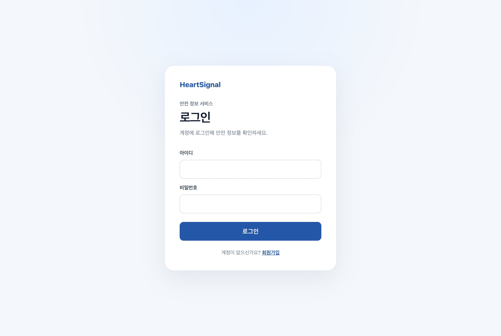 |  |

- 아이디 · 비밀번호로 Java 인증 서버(`/api/auth/*`)에 로그인합니다. 성공하면 `ACCESS_TOKEN` 쿠키(JWT, 1시간)가 생기고 홈으로 이동합니다.
- 시연 계정은 `admin1` · `foreman1` · `worker1` 입니다 (`db/seed-demo-users.sh`).
- 로그인하지 않았거나 토큰이 만료돼 API 가 401 을 돌려주면, 어느 화면에서든 로그인 화면으로 돌아옵니다.

## 3. 홈 — 평상시

| 작업자 | 안전관리자 |
| --- | --- |
| 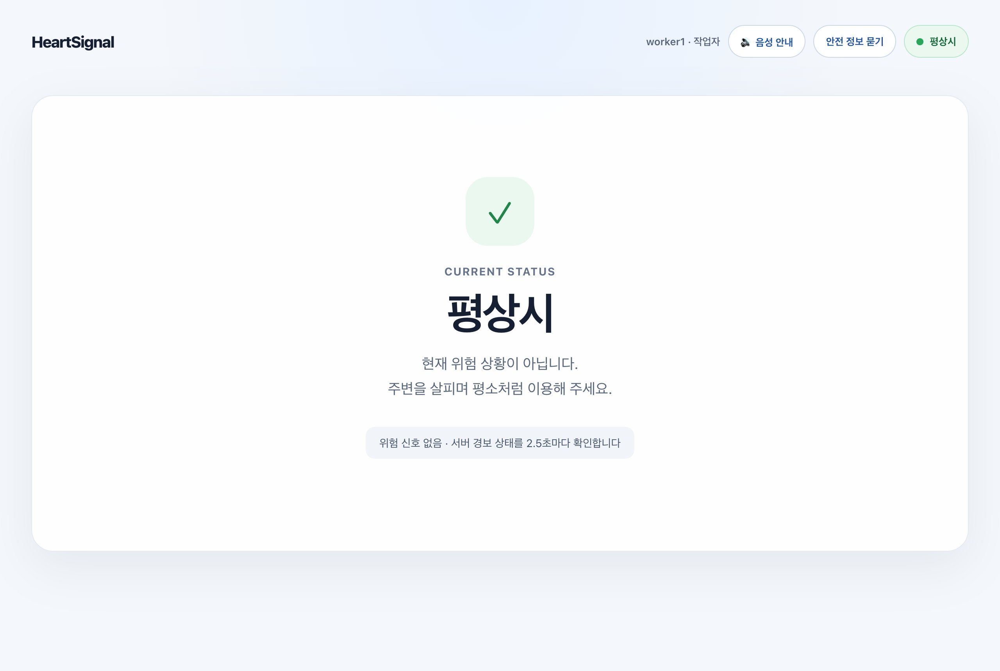 | 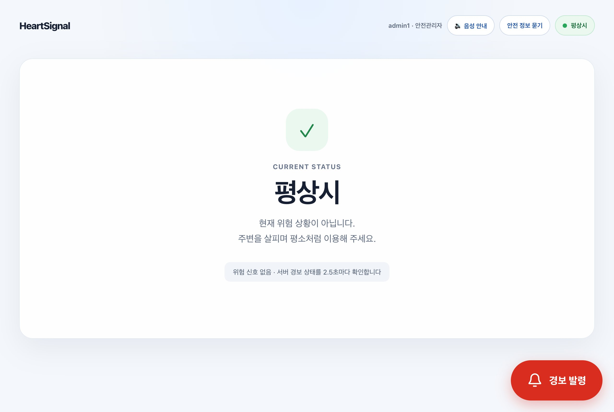 |

- 상단 오른쪽에 로그인 사용자 · 역할, **음성 안내** 켜기/끄기, **안전 정보 묻기**(챗봇), 현재 단계 배지가 있습니다.
- 진행 중인 경보가 없으면 초록 체크와 "평상시"를 표시합니다.
- 안전관리자에게만 오른쪽 아래 빨간 **경보 발령** 버튼이 보입니다.

## 4. 경보 발령 (안전관리자)

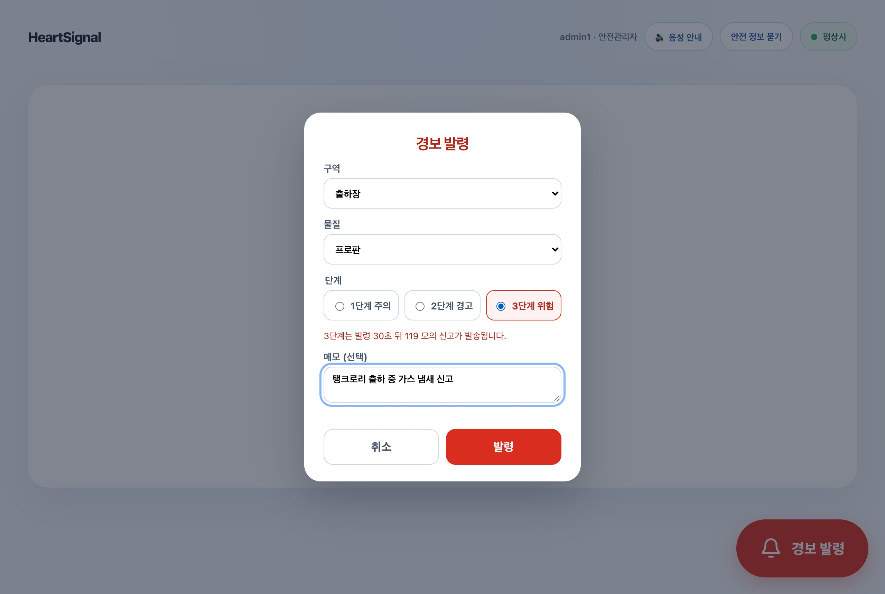

- 구역(출하장 · 증류탑 · 밀폐공간·탱크), 물질, 단계(1 주의 · 2 경고 · 3 위험), 메모를 고르고 **발령**을 누릅니다.
- 3단계를 고르면 "발령 30초 뒤 119 모의 신고가 발송됩니다" 안내가 뜹니다.
- 경보 발령 · 해제는 **사람(안전관리자)만** 합니다. 서버도 `admin` 이 아니면 403 으로 막습니다 (AGENTS.md 2장 1번).

## 5. 119 모의 신고 대기 (3단계)

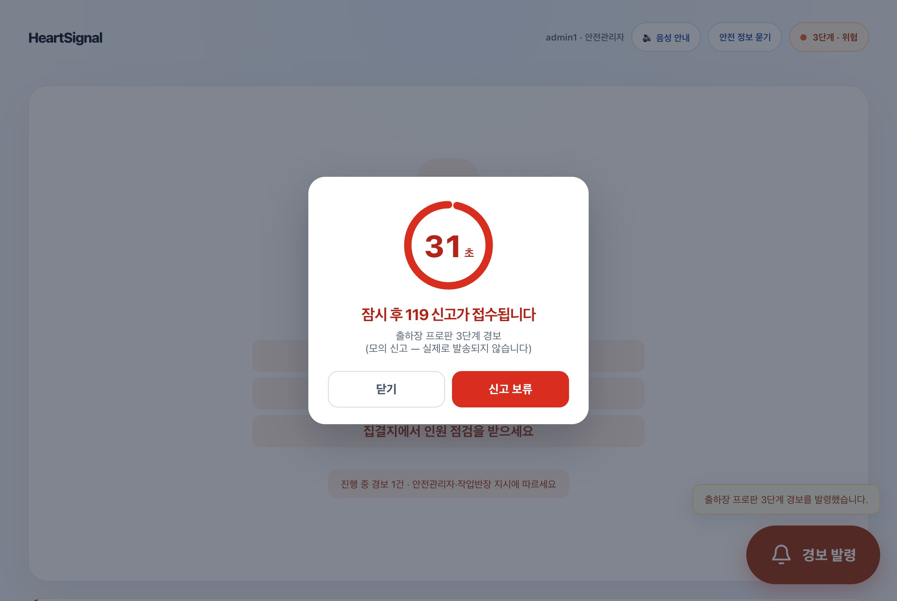

- 3단계를 발령하면 원형 타이머로 **30초 카운트다운**이 시작됩니다. 따로 누르지 않으면 30초 뒤에 신고문이 자동으로 발송됩니다.
- **신고 보류**: 오경보일 때 안전관리자가 30초 안에 누르면 신고가 나가지 않습니다.
- **닫기**: 창만 닫습니다. 신고는 그대로 진행됩니다.
- 발송은 **모의 발송**입니다(로그 + 화면 표시). 실제 119 로는 보내지 않습니다 (AGENTS.md 2장 5번).

## 6. 홈 — 경보 중 (안전관리자)

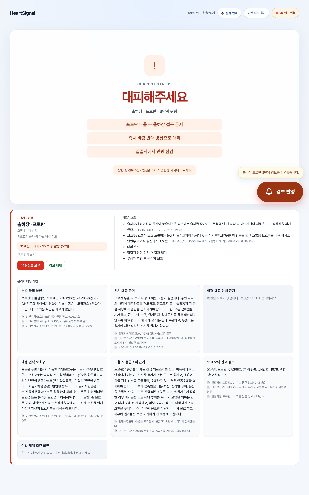

**전광판 영역 (위)**
- 단계별 문구("대피해주세요")와 구역 · 물질 · 단계, 그리고 전광판 문구 3~4줄을 크게 표시합니다.
- 문구는 고정 템플릿입니다. 물질에 초기이격거리 문서가 있으면 "접근 금지 반경 ○○m" 줄이 추가됩니다.

**경보 카드 (아래)**
- 왼쪽에는 발령 시각, 메모, 119 신고 상태(대기 · 보류 · 발송), 인원 점검 결과가 있습니다. 안전관리자는 **119 신고 보류** · **경보 해제** 버튼을 씁니다.
- 오른쪽은 **체크리스트**입니다. 문서에서 가져온 항목에는 출처(예: `KOSHA GUIDE G-78-2021 10.2(13)`)가 붙습니다.

### 6.1 관리자 대응 지침 7칸

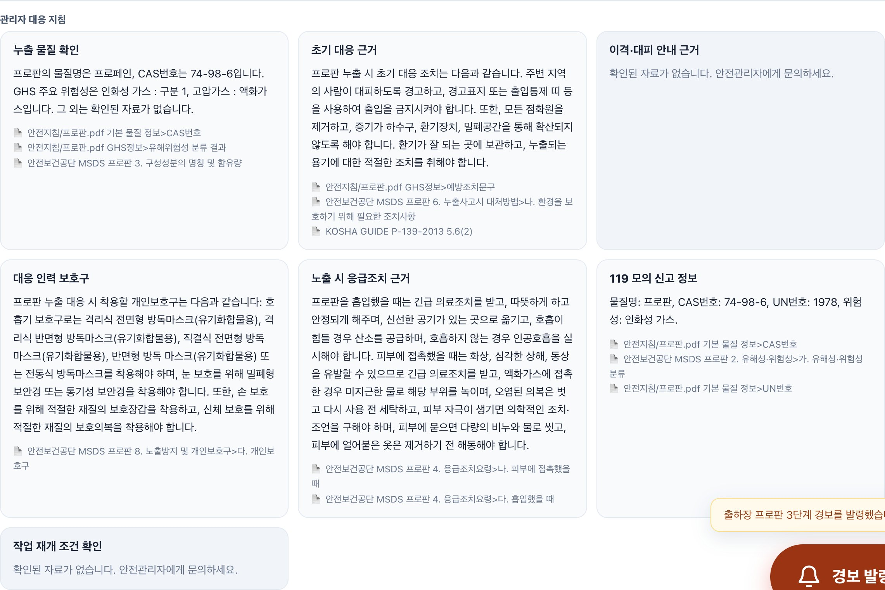

| 칸 | 내용 |
| --- | --- |
| 누출 물질 확인 | 물질명 · CAS · GHS 위험성 |
| 초기 대응 근거 | 경고 · 출입 통제 · 점화원 제거 등 |
| 이격 · 대피 안내 근거 | 초기이격거리 · 대피 방향 |
| 대응 인력 보호구 | 호흡 보호구 · 보안경 · 보호복 |
| 노출 시 응급조치 근거 | 흡입 · 피부 접촉 시 조치 |
| 119 모의 신고 정보 | 물질명 · CAS · UN번호 · 위험성 |
| 작업 재개 조건 확인 | 재측정 · 재개 승인 조건 |

- 각 칸은 RAG 답변이고, 아래에 📄 출처(`source section`)가 붙습니다.
- **회색 칸**은 근거 문서가 없는 경우(`handoff`)입니다. LLM 을 부르지 않고 "확인된 자료가 없습니다. 안전관리자에게 문의하세요."를 표시합니다. 위 화면에서는 프로판의 이격 · 대피와 재개 조건이 이 경우입니다.
- **"검토 필요"** 배지는 근거가 1건뿐이거나 수치를 확인해야 할 때(`needs_review`) 붙습니다.
- LLM 장애로 답변을 만들지 못하면 "상세 답변을 만들지 못했습니다. 안전지침 원문과 작업반장 체크리스트를 확인하세요."를 표시합니다.
- 7칸은 경보를 **발령할 때** 한 번 만듭니다. 발령 직후 몇 초 걸릴 수 있습니다.

## 7. 홈 — 경보 중 (작업반장)

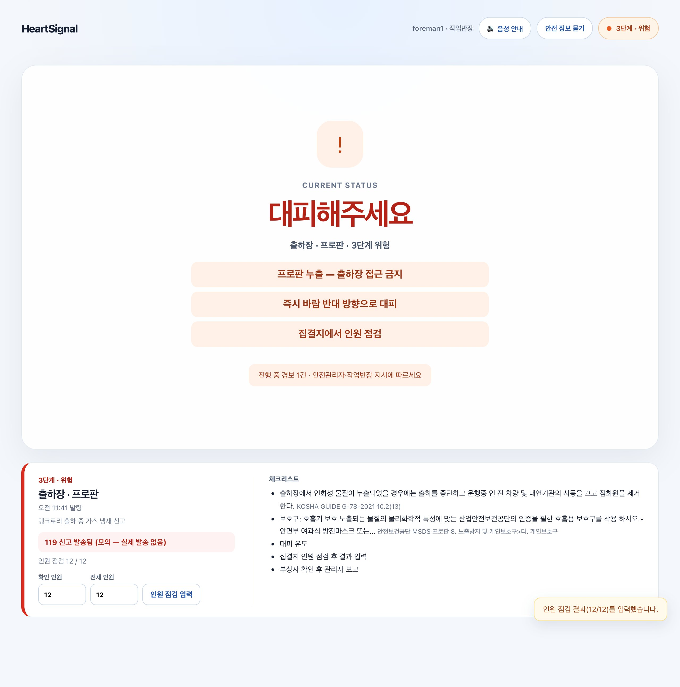

- 전광판과 체크리스트를 봅니다.
- 집결지에서 인원을 점검한 뒤 **확인 인원 / 전체 인원**을 입력하고 **인원 점검 입력**을 누르면, 모든 화면에 "인원 점검 12 / 12"가 반영됩니다. 이 값은 119 후속 보고에도 쓰입니다.
- 작업반장은 경보 발령 · 해제 · 신고 보류를 할 수 없습니다.

## 8. 홈 — 경보 중 (작업자)

| 데스크톱 | 모바일 (390px) |
| --- | --- |
| 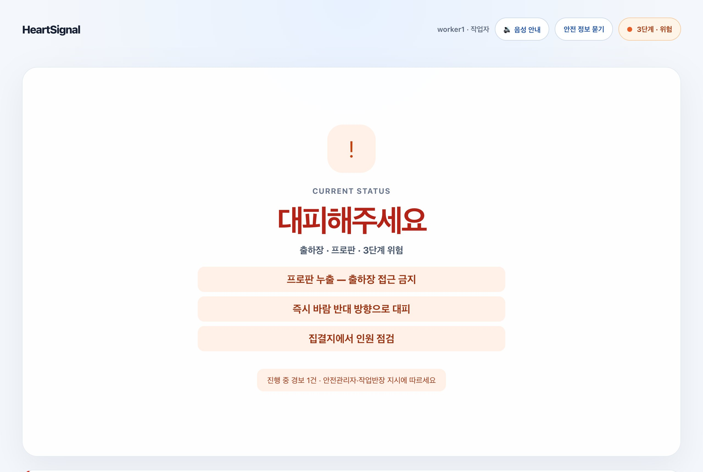 | 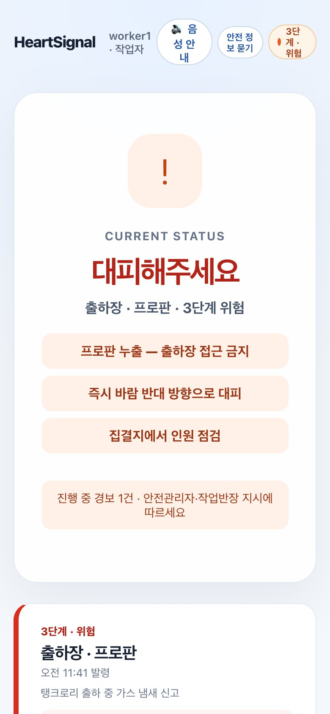 |

- 작업자는 **상태와 전광판 문구만** 봅니다. 체크리스트 · 지침 · 조작 버튼은 보이지 않습니다.
- 화면 배경과 문구 색은 단계에 따라 바뀝니다(1단계 주의, 2·3단계 위험색).
- ⚠️ **알려진 문제**: 모바일 폭(390px)에서 상단 버튼 글자가 "음 / 성 안 / 내"처럼 세로로 쪼개집니다. 상단 버튼 배치를 좁은 화면용으로 고쳐야 합니다 (P4 후속 작업).

## 9. 119 모의 신고 발송 후

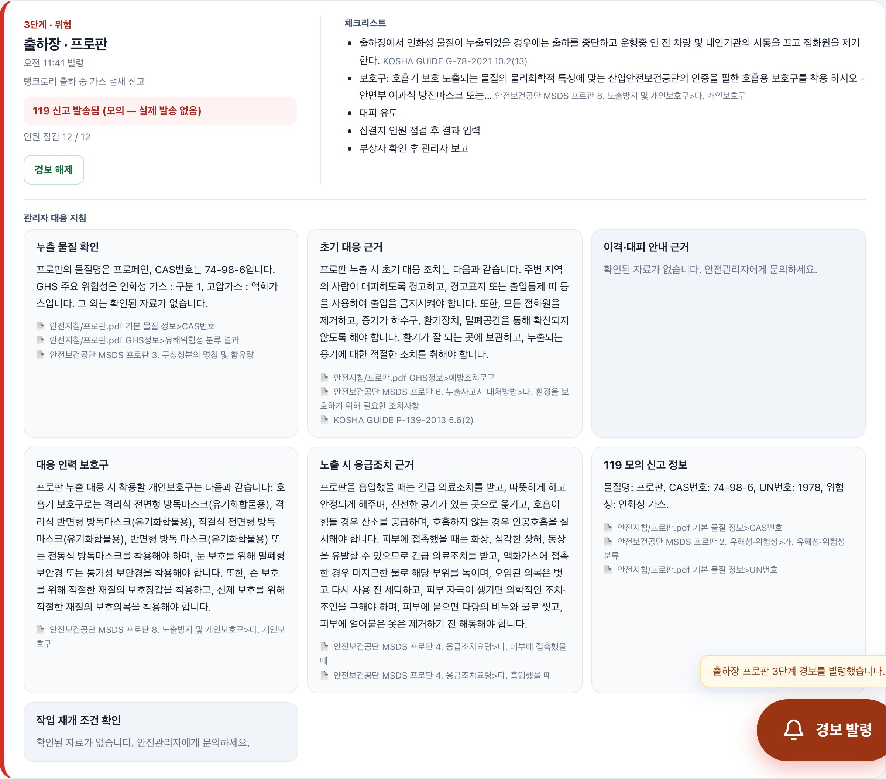

- 30초가 지나면 상태가 **"119 신고 발송됨 (모의 — 실제 발송 없음)"** 으로 바뀌고, **119 신고 보류** 버튼이 사라집니다.
- 신고문 내용(물질 · CAS · UN · 이격거리 · 인원 점검)과 출처는 서버 감사 로그에 남습니다.

## 10. 경보 해제 (안전관리자)

| 해제 확인 | 해제 후 화면 (작업자) |
| --- | --- |
| 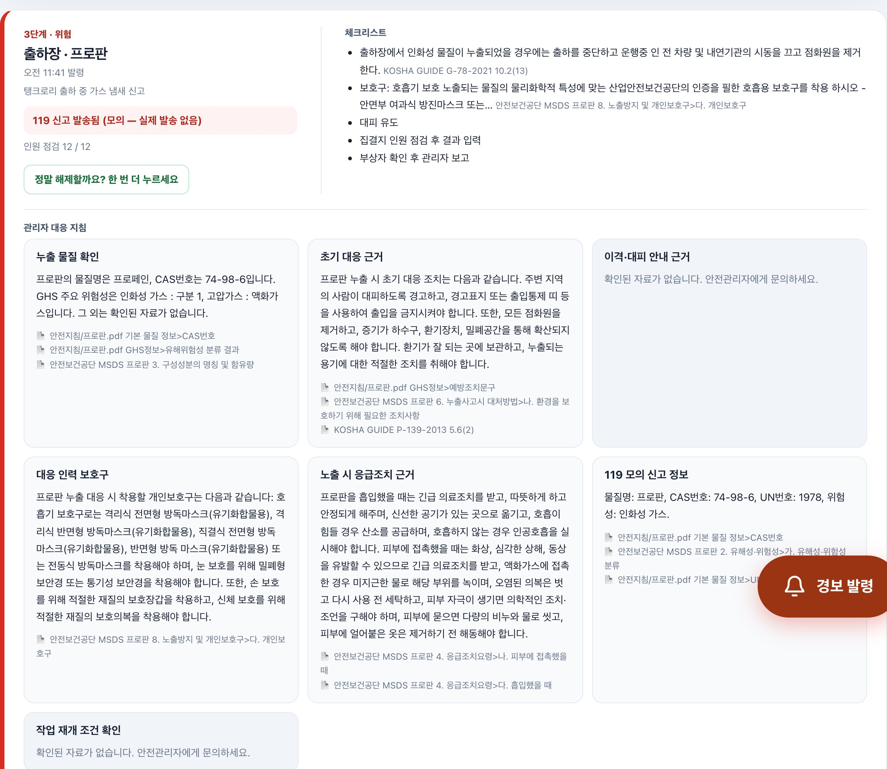 | 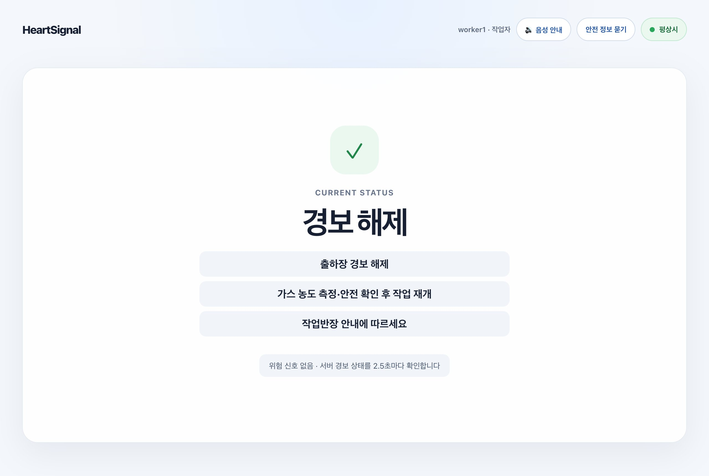 |

- 실수로 누르는 것을 막으려고 **두 번 눌러야** 해제됩니다. 처음 누르면 "정말 해제할까요? 한 번 더 누르세요"로 바뀝니다.
- 해제 후 **60초 동안** 모든 화면에 "경보 해제"와 재개 문구("가스 농도 측정·안전 확인 후 작업 재개")를 표시하고, 그 뒤 평상시로 돌아갑니다.
- 재개 문구는 KOSHA G-78 10.2(14) 근거가 있을 때 나옵니다. 작업 재개는 안전관리자가 승인합니다.

## 11. 음성 안내 (홈)

- 새 경보가 뜨면 "출하장 프로판 3단계 위험 경보입니다." 다음에 전광판 문구를 읽습니다. **3단계는 2번** 읽고, 해제 문구도 1번 읽습니다.
- 음성은 Voice-AI `/voice/tts/`(OpenAI 음성 합성)로 만듭니다. 실패하거나 15초 안에 답이 없으면 **브라우저 내장 음성**으로 바로 읽습니다.
- 브라우저는 화면을 한 번도 누르지 않으면 소리를 막습니다. 그러면 상단 버튼이 **"🔊 눌러서 음성 듣기"** 로 바뀌고, 화면 아무 곳이나 누르면 놓친 안내를 다시 읽습니다.
- **🔇 음성 꺼짐**으로 끄면 읽던 음성도 멈춥니다. 켜짐 여부는 그 브라우저에만 기억합니다.

## 12. 안전 정보 챗봇

| 처음 화면 | 답변 + 출처 | 근거 없음 (handoff) |
| --- | --- | --- |
| 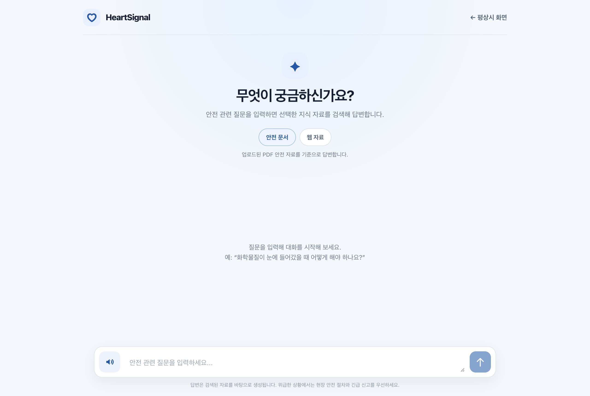 | 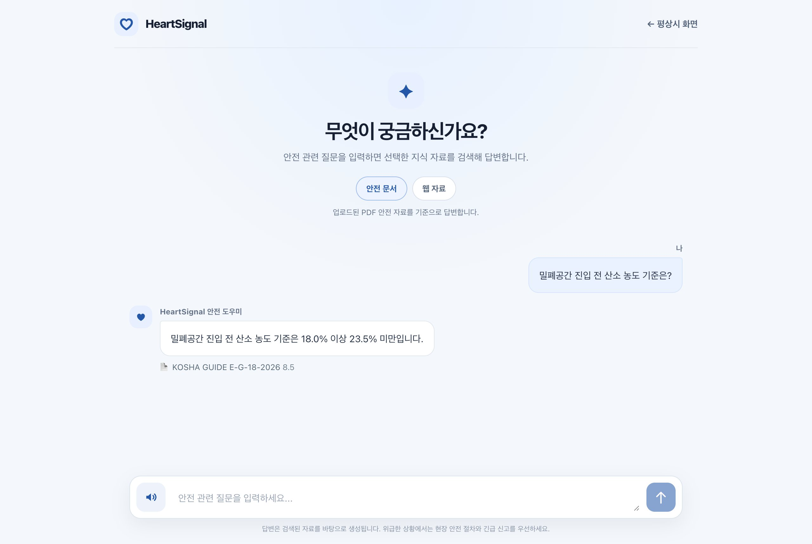 | 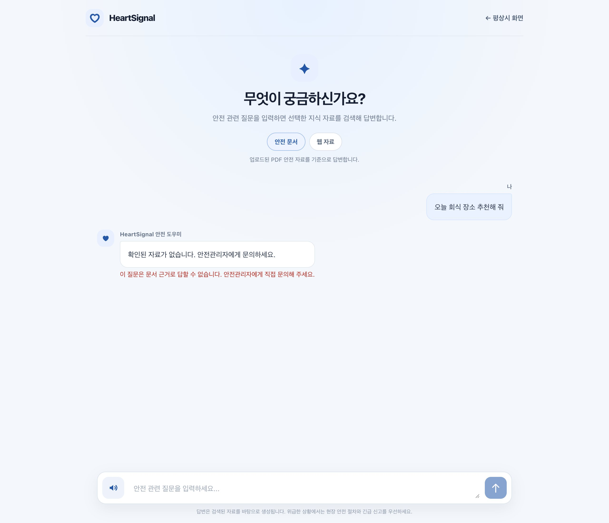 |

- **안전 문서**(PDF 안전지침 · KOSHA) 또는 **웹 자료**를 골라 질문합니다.
- 답변 아래에 📄 출처가 붙습니다. 예: "밀폐공간 진입 전 산소 농도 기준은?" → "18.0% 이상 23.5% 미만" · `KOSHA GUIDE E-G-18-2026 8.5`
- 안전과 상관없는 질문처럼 근거 문서가 0건이면 LLM 을 부르지 않습니다. 대신 "이 질문은 문서 근거로 답할 수 없습니다. 안전관리자에게 직접 문의해 주세요."를 표시합니다.
- 근거가 1건뿐이거나 수치 확인이 필요하면 "⚠ 원문을 확인하세요" 경고가 붙습니다.
- 한글을 입력하는 중(조합 중)에 누른 Enter 는 전송하지 않습니다. Shift+Enter 는 줄바꿈입니다.

### 12.1 음성으로 묻고 듣기

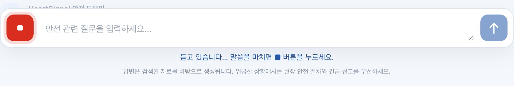

1. 입력창 왼쪽 **파란 스피커 버튼**을 누르면 녹음을 시작합니다. 처음 한 번은 브라우저가 마이크 권한을 묻습니다.
2. 녹음 중에는 버튼이 **빨간 ■**로 바뀌어 깜빡이고, "듣고 있습니다…"가 표시됩니다.
3. ■를 누르면 Voice-AI `/voice/stt/`(서버 내 Whisper)가 음성을 글자로 바꾸고, 그 글자로 바로 질문합니다.
4. 답변이 오면 화면에 표시하면서 **음성으로 읽어 줍니다**. 근거가 없는 답변이면 "안전관리자에게 직접 문의해 주세요"까지 읽습니다. 글로 친 질문은 읽지 않습니다.

- 녹음 원본은 브라우저에 남기지 않고, Voice-AI 도 글자로 바꾼 뒤 파일을 지웁니다 (AGENTS.md 2장 7번).
- Voice-AI 에 연결할 수 없으면 "음성 인식 서버(Voice-AI)에 연결할 수 없습니다"를 표시합니다.
- 마이크는 https 또는 localhost 에서만 동작합니다.

---

## 13. 스크린샷 다시 찍기

화면이 바뀌면 같은 순서로 다시 찍어 `docs/screenshots/web-*.jpg` 를 덮어씁니다.

1. 로컬에서 DB · auth · rag · voice 를 띄우고 `cd web && npm run dev` 를 실행합니다 (README Quick Start).
2. 로그인 → 평상시 → S1(출하장 · 프로판 · 3단계) 발령 → 119 대기 창 → 작업반장 인원 점검(12/12) → 30초 뒤 발송 확인 → 챗봇 질문 2개(근거 있음 / 없음) → 마이크 → 경보 해제 순서로 찍습니다.
3. 해상도는 1280×860(모바일 390×844), 배율 2배, JPEG 입니다.
